# 00. TỔNG QUAN NGHIỆP VỤ & HÀNH TRÌNH NGƯỜI DÙNG (AUTH)
## Module `auth-service` · Đăng ký, xác minh, đăng nhập, phiên, mật khẩu

> Tài liệu này mô tả nghiệp vụ **từ góc nhìn người dùng**: họ đi qua những màn hình, bước nào, gặp nhánh rẽ nào, và hệ thống làm gì ở mỗi bước. Mọi quy tắc và con số ở đây được đối chiếu với code hiện tại (branch `refactor/auth-service-cleanup`, commit `a89dba1`) và `app/src/main/resources/application.yml`.
>
> Đặc tả API chi tiết (request/response, bảng lỗi, lưu trữ) nằm ở các tài liệu chuyên đề:
>
> | File | Nội dung |
> |---|---|
> | [01_AUTH_REGISTER_FLOW.md](01_AUTH_REGISTER_FLOW.md) | API đăng ký, mã hóa CCCD |
> | [02_AUTH_LOGIN_FLOW.md](02_AUTH_LOGIN_FLOW.md) | API đăng nhập, khóa tạm, rate limit, đổi/quên mật khẩu |
> | [03_AUTH_REFRESH_TOKEN_FLOW.md](03_AUTH_REFRESH_TOKEN_FLOW.md) | Phiên, refresh token rotation, đăng xuất |
> | [04_AUTH_AUDIT_LOG.md](04_AUTH_AUDIT_LOG.md) | Nhật ký bảo mật |
> | [05_AUTH_CONTACT_VERIFICATION.md](05_AUTH_CONTACT_VERIFICATION.md) | Xác minh SĐT/email, quên mật khẩu qua SMS |
>
> **Đọc nhanh**: §1 (bức tranh chung) → §3 (đăng ký) → §4 (đăng nhập) → §10 (điểm cần quyết định).

---

## MỤC LỤC

1. [Bức tranh chung](#1-bức-tranh-chung)
2. [Trạng thái tài khoản và quyền](#2-trạng-thái-tài-khoản-và-quyền)
3. [Đăng ký tài khoản](#3-đăng-ký-tài-khoản)
4. [Xác minh số điện thoại và email](#4-xác-minh-số-điện-thoại-và-email)
5. [Đăng nhập](#5-đăng-nhập)
6. [Sau khi đăng nhập: gọi API, tự gia hạn phiên, đăng xuất](#6-sau-khi-đăng-nhập-gọi-api-tự-gia-hạn-phiên-đăng-xuất)
7. [Quên mật khẩu và đổi mật khẩu](#7-quên-mật-khẩu-và-đổi-mật-khẩu)
8. [Hành trình đầu-cuối tiêu biểu](#8-hành-trình-đầu-cuối-tiêu-biểu)
9. [Tham số nghiệp vụ](#9-tham-số-nghiệp-vụ)
10. [Điểm cần lưu ý và câu hỏi mở](#10-điểm-cần-lưu-ý-và-câu-hỏi-mở)
11. [Quy tắc nằm ở đâu trong code](#11-quy-tắc-nằm-ở-đâu-trong-code)

---

## 1. BỨC TRANH CHUNG

### 1.1. Khái niệm cốt lõi

| Khái niệm | Ý nghĩa nghiệp vụ |
|---|---|
| **Tài khoản** | Một người dùng Sunvibe. Định danh bằng **số điện thoại** (cũng là tên đăng nhập, `username`). Email và CCCD là tùy chọn |
| **Đăng ký trước, xác minh sau** | Đăng ký xong là dùng app được ngay, nhưng tài khoản ở trạng thái `PENDING` cho tới khi người dùng nhập đúng mã SMS gửi tới số điện thoại |
| **Phiên đăng nhập** | Mỗi lần đăng nhập trên một thiết bị tạo một phiên riêng. Một người có thể có nhiều phiên song song (điện thoại, laptop, ...) |
| **Access token** | "Vé" ngắn hạn (15 phút) để gọi API. Hết hạn thì app tự đổi vé mới, người dùng không nhận ra |
| **Refresh token** | "Vé gia hạn" của phiên, nằm trong cookie HttpOnly. Phiên tự kết thúc nếu không dùng app 7 ngày, và chậm nhất 30 ngày sau khi đăng nhập |
| **Mã OTP** | Mã 6 chữ số gửi qua SMS hoặc email, dùng để xác minh SĐT/email hoặc đặt lại mật khẩu |
| **Khóa tạm** | Sai mật khẩu 5 lần liên tiếp thì đăng nhập bằng mật khẩu bị chặn một thời gian (15 phút, tăng dần). Tự mở khóa |
| **Khóa (`LOCK`)** | Do quản trị viên đặt. Chặn hoàn toàn, có hiệu lực ngay cả với token đang còn hạn |

### 1.2. Bản đồ chức năng

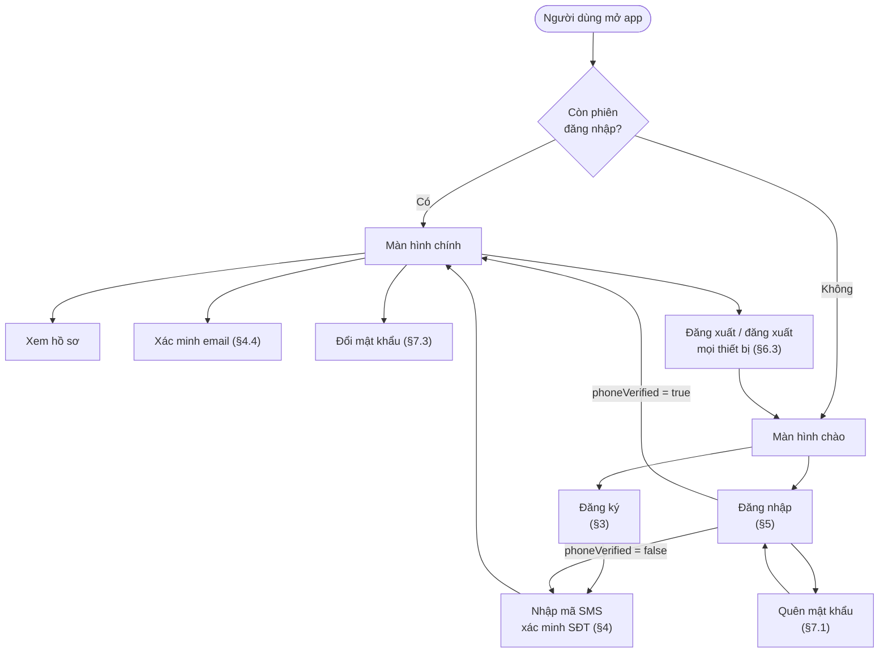

### 1.3. Danh sách endpoint

| Nhóm | Method + endpoint | Cần đăng nhập | Rate limit / IP |
|---|---|---|---|
| Đăng ký | `POST /api/users/command/register` | Không | 5 / giờ |
| Đăng nhập | `POST /api/auth/login` | Không | 10 / phút |
| Phiên | `POST /api/auth/refresh-token` | Không (dùng cookie refresh) | 30 / phút |
| Phiên | `POST /api/auth/logout` | Không (dùng cookie refresh) | — |
| Phiên | `POST /api/auth/logout-all` | Có | — |
| Xác minh | `POST /api/auth/verification/phone/send` | Có | 5 / giờ |
| Xác minh | `POST /api/auth/verification/phone/confirm` | Có | 10 / 15 phút |
| Xác minh | `POST /api/auth/verification/email/send` | Có | 5 / giờ |
| Xác minh | `POST /api/auth/verification/email/confirm` | Có | 10 / 15 phút |
| Mật khẩu | `POST /api/auth/forgot-password` (email) | Không | 5 / giờ |
| Mật khẩu | `POST /api/auth/forgot-password/sms` | Không | 5 / giờ |
| Mật khẩu | `POST /api/auth/reset-password` | Không | 10 / 15 phút |
| Mật khẩu | `POST /api/auth/change-password` | Có | 10 / 15 phút |
| Hồ sơ | `GET /api/user/query/my-info` | Có | — |

Rate limit đếm theo **IP của client**, chạy trước mọi xử lý khác. Vượt giới hạn trả **429** + header `Retry-After` (giây) với message `Too many requests. Please try again later.`

### 1.4. Quy ước mã lỗi chung

| HTTP | Khi nào | Body |
|---|---|---|
| **406** | Dữ liệu nhập sai định dạng (Bean Validation trên DTO) | `{"message":"Validation failed.","errors":[{"field":...,"message":...}]}` |
| **409** | Vi phạm quy tắc nghiệp vụ theo field (trùng SĐT/email/CCCD, email sai định dạng, sai mật khẩu hiện tại) | Cùng định dạng với 406 |
| **400** | Mã OTP/mã xác minh sai, hết hạn, đã hủy | `{"code":400,"message":...,"errorTime":...}` |
| **401** | Sai thông tin đăng nhập, tài khoản bị khóa/vô hiệu, phiên hết hạn, chưa đăng nhập | `{"code":401,...}` |
| **404** | Tài khoản của người đang đăng nhập không còn tồn tại | `{"code":404,...}` |
| **423** | Đang bị khóa tạm vì sai mật khẩu nhiều lần (+ `Retry-After`) | `{"code":423,...}` |
| **429** | Rate limit theo IP, hoặc xin mã quá sớm / quá nhiều (+ `Retry-After`) | `{"code":429,...}` |

Mọi response thành công có dạng `{"code": ..., "message": ..., "result": ...}`.

---

## 2. TRẠNG THÁI TÀI KHOẢN VÀ QUYỀN

### 2.1. Vòng đời tài khoản

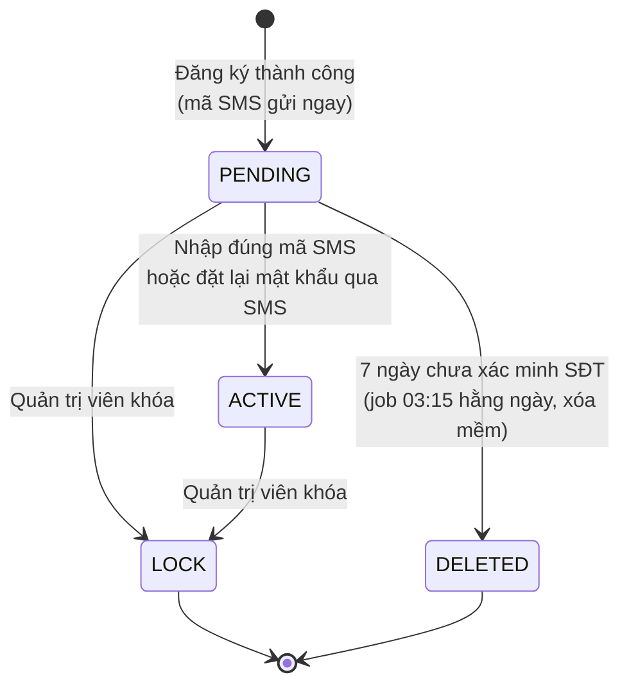

`TERMINATED` (đóng vĩnh viễn) có trong mô hình nhưng hiện **chưa có luồng nào** chuyển tài khoản sang trạng thái này. Chưa có API nào cho quản trị viên khóa/mở khóa; trạng thái `LOCK` hiện chỉ đặt được trực tiếp trong DB.

### 2.2. Mỗi trạng thái được làm gì

| Hành động | `PENDING` | `ACTIVE` | `LOCK` | `TERMINATED` | `DELETED` |
|---|---|---|---|---|---|
| Đăng nhập bằng mật khẩu | Được | Được | 401 *locked or disabled* | 401 *locked or disabled* | 401 *Incorrect username or password* (coi như không tồn tại) |
| Gọi API bằng token còn hạn | Được | Được | Bị từ chối ngay | Bị từ chối ngay | Bị từ chối ngay |
| Tự gia hạn phiên (refresh) | Được | Được | Phiên bị thu hồi | Phiên bị thu hồi | Phiên bị thu hồi |
| Xin / nhập mã xác minh | Được | Được (email) | — | — | — |
| Quên mật khẩu qua SMS | Được | Được | Không gửi gì | Không gửi gì | Không gửi gì |
| Quên mật khẩu qua email | Chỉ khi email đã xác minh | Chỉ khi email đã xác minh | Không gửi gì | Không gửi gì | Không gửi gì |
| Authority `PHONE_VERIFIED` | Không | Có | — | — | — |

"Không gửi gì" vẫn trả về câu trả lời chung như khi gửi thành công, để không lộ trạng thái tài khoản (§7.1).

### 2.3. Quyền (authorities)

Ở **mỗi request**, hệ thống nạp lại tài khoản từ DB và cấp quyền:

| Authority | Điều kiện |
|---|---|
| `ROLE_TENANT` (và các `ROLE_<tên role>` khác) | Theo bảng role của tài khoản. Tự đăng ký luôn chỉ có `TENANT` |
| `PHONE_VERIFIED` | Đã xác minh số điện thoại |
| `EMAIL_VERIFIED` | Có email và đã xác minh email hiện tại |

Vì nạp lại mỗi request nên xác minh SĐT, đổi role hay khóa tài khoản đều **có hiệu lực ngay ở request kế tiếp**, không cần đăng nhập lại. Các module khác (booking, đăng tin, ...) dùng `@PreAuthorize("hasAuthority('PHONE_VERIFIED')")` để chặn tài khoản chưa xác minh; hiện **chưa module nào áp dụng**.

---

## 3. ĐĂNG KÝ TÀI KHOẢN

### 3.1. Mục tiêu và quyết định nghiệp vụ

- Người dùng tự tạo tài khoản bằng **số điện thoại + mật khẩu + họ tên**, ít thông tin nhất có thể.
- Đăng ký xong được **đăng nhập luôn** trên thiết bị đó, không phải nhập lại mật khẩu.
- **Đăng ký trước, xác minh sau**: chưa cần xác minh SĐT mới được vào app. Tài khoản ở `PENDING`, mã SMS được gửi ngay. Không xác minh trong 7 ngày thì tài khoản bị vô hiệu hóa và số điện thoại được giải phóng.
- Vai trò luôn là **`TENANT`** (người thuê). Client không chọn được vai trò; ADMIN/SUPER_ADMIN không bao giờ tự đăng ký được.
- Email và CCCD là **tùy chọn**. Email có thì được gửi mã xác minh, nhưng không bắt buộc xác minh.

### 3.2. Hành trình người dùng

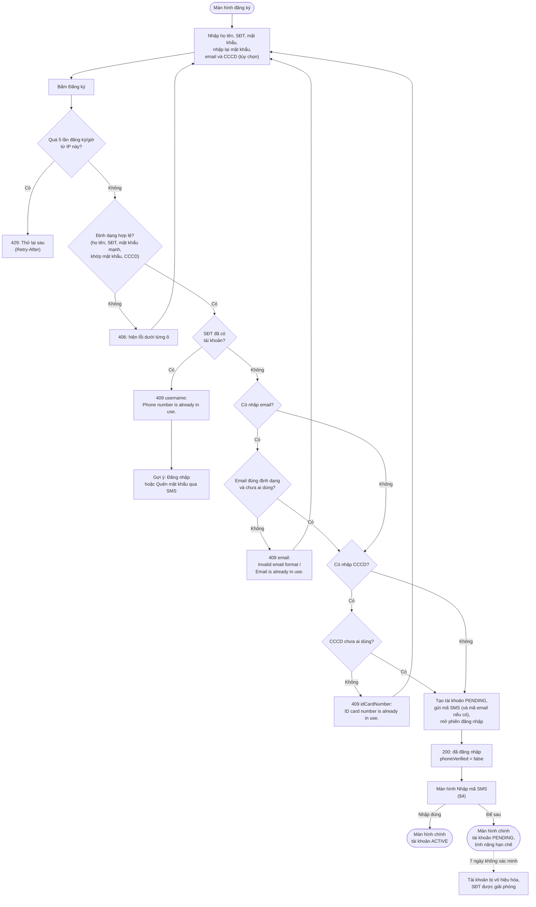

### 3.3. Dữ liệu nhập và quy tắc

| Ô nhập | Bắt buộc | Quy tắc | Lỗi khi sai |
|---|---|---|---|
| Họ tên (`fullName`) | Có | 6–100 ký tự | 406 `From 6 to 100 characters in length.` |
| Số điện thoại (`username`) | Có | 10–12 chữ số, không dấu cách, không `+84` | 406 `Phone numbers must be between 10 and 12 digits.` |
| Mật khẩu (`password`) | Có | 8–72 ký tự; có ít nhất 1 chữ hoa, 1 chữ thường, 1 chữ số, 1 ký tự trong `@$!%*?&`; **chỉ** được dùng chữ cái Latin không dấu, chữ số và các ký tự đặc biệt đó | 406 `Password must be at least 8 characters.` / `... at most 72 characters.` / `Password must contain uppercase, lowercase, number and special character.` |
| Nhập lại mật khẩu (`confirmPassword`) | Có | Trùng mật khẩu | 406 (field `confirmPassword`) `Confirm password must match password.` |
| Email | Không | Tối đa 100 ký tự, đúng định dạng email. Để trống / chỉ có dấu cách = không nhập | 406 khi quá dài; 409 `Invalid email format.` khi sai định dạng |
| CCCD (`idCardNumber`) | Không | 9 chữ số (CMND) hoặc 12 chữ số (CCCD). Để trống = không nhập | 406 `ID card number must be a 9-digit CMND or 12-digit CCCD.` |

Ghi chú cho frontend:
- Mật khẩu có dấu cách, chữ có dấu tiếng Việt hoặc ký tự đặc biệt khác (`#`, `-`, `_`, ...) đều bị từ chối. Nên hiển thị quy tắc ngay dưới ô mật khẩu.
- Email được chuyển về chữ thường trước khi lưu và so trùng: `An@Example.com` và `an@example.com` là một.
- Thiếu field bắt buộc báo `... is mandatory.`

### 3.4. Thứ tự hệ thống kiểm tra

Hệ thống kiểm tra theo đúng thứ tự dưới đây và **dừng ở lỗi đầu tiên** của mỗi lớp:

1. **Rate limit theo IP**: tối đa 5 lần gọi đăng ký / giờ / IP (tính cả lần thất bại).
2. **Định dạng (406)**: kiểm tra tất cả các ô cùng lúc, trả về **toàn bộ** lỗi để form hiện một lần.
3. **Nghiệp vụ (409)**, lần lượt:
   1. Số điện thoại đã thuộc một tài khoản chưa bị xóa?
   2. Email (nếu có): đúng định dạng? đã thuộc tài khoản khác chưa bị xóa?
   3. CCCD (nếu có): đã thuộc tài khoản khác chưa bị xóa? (so qua mã băm, không giải mã)

Tài khoản **đã bị xóa mềm** (kể cả bị vô hiệu hóa vì không xác minh) **không** được tính là trùng: số điện thoại, email, CCCD của nó đăng ký lại được.

### 3.5. Hệ thống tạo ra những gì

Tất cả nằm trong **một transaction**: hoặc tạo đủ, hoặc không tạo gì.

| Thành phần | Giá trị |
|---|---|
| Tài khoản | ID dạng ULID; trạng thái `PENDING`; KYC `UNVERIFIED`; ảnh đại diện mặc định; mật khẩu băm BCrypt; CCCD mã hóa AES-256-GCM + mã băm để kiểm trùng |
| Vai trò | `TENANT` |
| Mã xác minh SĐT | 6 chữ số, hiệu lực 10 phút, gửi SMS ngay: *"Ma xac minh Sunvibe cua ban la 123456. Ma het han sau 10 phut. Khong chia se ma nay cho bat ky ai."* |
| Mã xác minh email | Chỉ khi có email. 6 chữ số, 10 phút, gửi email *"Verify your email address"* |
| Phiên đăng nhập | Một phiên mới cho thiết bị đang đăng ký (lưu User-Agent, IP), access token 15 phút, refresh token |
| `last_login` | Thời điểm đăng ký |
| Nhật ký bảo mật | `USER_REGISTERED`, `PHONE_VERIFICATION_SENT`, (`EMAIL_VERIFICATION_SENT`) |

**Gửi mã thất bại không làm hỏng đăng ký**: nhà cung cấp SMS/email lỗi thì đăng ký vẫn thành công, người dùng bấm "Gửi lại mã" ở màn hình xác minh.

Mật khẩu vừa đặt nên **không** kiểm tra lại khi mở phiên đầu tiên.

### 3.6. Luồng xử lý phía server

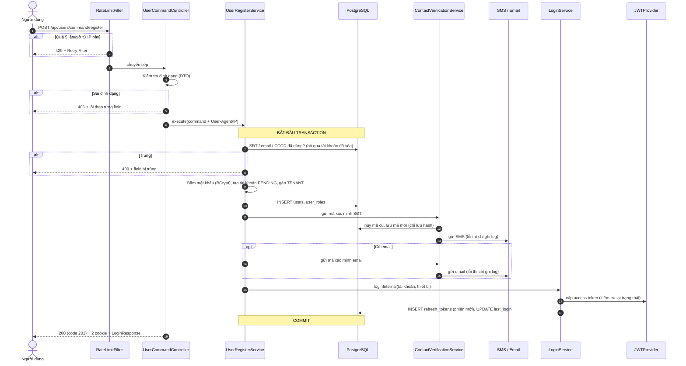

Response thành công (HTTP 200, `code` trong body là 201):

```json
{
  "code": 201,
  "message": "User registered successfully.",
  "result": {
    "tokenType": "JWT",
    "accessToken": "eyJ0eXAiOiJKV1Qi...",
    "expiresIn": 900,
    "username": "0912345678",
    "userEmail": "an.nguyen@example.com",
    "roles": ["TENANT"],
    "phoneVerified": false,
    "emailVerified": false,
    "message": "User registered successfully."
  }
}
```

Frontend dựa vào `phoneVerified = false` để chuyển sang màn hình nhập mã SMS.

### 3.7. Các tình huống nghiệp vụ

| Tình huống | Hệ thống xử lý | Người dùng nên làm |
|---|---|---|
| Đăng ký bằng số đã có tài khoản (của chính mình) | 409 `Phone number is already in use.` | Đăng nhập, hoặc quên mật khẩu qua SMS |
| **Số của mình bị người khác đăng ký trước** (họ không xác minh được vì không nhận được SMS) | 409 như trên | Dùng **quên mật khẩu qua SMS**: mã đến điện thoại của mình, đặt lại mật khẩu xong thì tài khoản thuộc về mình và SĐT được xác minh (§8.3). Hoặc chờ: sau 7 ngày tài khoản kia tự bị vô hiệu hóa, số được giải phóng |
| Đăng ký lại số của tài khoản đã bị vô hiệu hóa (ví dụ quá 7 ngày không xác minh) | Được: tạo tài khoản **mới hoàn toàn**, dữ liệu cũ không được khôi phục | — |
| Nhập email của người khác | Đăng ký thành công; mã xác minh gửi tới email đó; email ở trạng thái **chưa xác minh** nên **không** dùng được cho quên mật khẩu | — |
| Email đã thuộc tài khoản khác | 409 `Email is already in use.` | Bỏ trống email, bổ sung sau |
| Không nhận được SMS | Đăng ký vẫn thành công | Bấm "Gửi lại mã" (sau 60 giây, tối đa 5 mã/ngày) |
| Bấm Đăng ký 2 lần liên tiếp (double submit) | Lần 2 nhận 409 `Phone number is already in use.` (nếu lần 1 đã xong). Nếu hai request **chạy đồng thời**, lần 2 có thể nhận **500** do ràng buộc duy nhất trong DB | Frontend nên khóa nút sau khi bấm |
| Đăng ký quá 5 lần/giờ từ cùng mạng | 429 | Chờ theo `Retry-After` |

---

## 4. XÁC MINH SỐ ĐIỆN THOẠI VÀ EMAIL

### 4.1. Vì sao phải xác minh

- Xác minh SĐT chứng minh người dùng thật sự sở hữu số đã đăng ký. Tài khoản chuyển `PENDING` → `ACTIVE` và nhận quyền `PHONE_VERIFIED`.
- Xác minh email là điều kiện để dùng email cho **quên mật khẩu**.

### 4.2. Hành trình xác minh SĐT

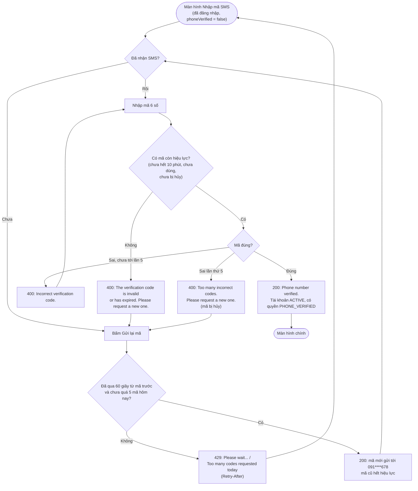

### 4.3. Quy tắc mã xác minh

| Quy tắc | Giá trị |
|---|---|
| Độ dài / hiệu lực | 6 chữ số / 10 phút |
| Nhập sai tối đa | 5 lần; lần thứ 5 hủy mã (kể cả nếu sau đó nhập đúng) |
| Gửi lại | Sau ít nhất 60 giây kể từ mã trước |
| Hạn mức | 5 mã / tài khoản / kênh / 24 giờ (SMS tốn tiền) |
| Chỉ một mã dùng được | Gửi mã mới thì mọi mã cũ của kênh đó bị hủy |
| Gắn với địa chỉ nhận | Mã gửi tới email A không xác minh được email B (nếu email đổi sau khi gửi) |
| Đã xác minh rồi | Gửi hoặc nhập mã trả 400 `This contact is already verified.` |
| Lưu trữ | Chỉ lưu hash có salt; số lần nhập sai được lưu dù request trả lỗi |
| Rate limit theo IP | Gửi 5/giờ, nhập 10/15 phút |

Sau khi xác minh thành công, quyền `PHONE_VERIFIED` có hiệu lực ngay ở request kế tiếp. Riêng cờ `phoneVerified` trong dữ liệu client đang giữ (từ response đăng nhập) **không tự cập nhật**: frontend tự đặt `true` khi nhận 200, hoặc gọi `GET /api/user/query/my-info`.

### 4.4. Xác minh email

Giống SĐT, qua `POST /api/auth/verification/email/send` và `.../email/confirm`, với khác biệt:
- Tài khoản không có email: gửi mã trả 400 `There is no email on this account to verify.`
- Xác minh email **không** đổi trạng thái tài khoản; chỉ thêm quyền `EMAIL_VERIFIED` và cho phép quên mật khẩu qua email.
- Hiện **chưa có API thêm/đổi email** sau đăng ký (logic đổi email đã có trong domain: đổi email thì mất trạng thái đã xác minh).

### 4.5. Tài khoản không xác minh: vòng đời 7 ngày

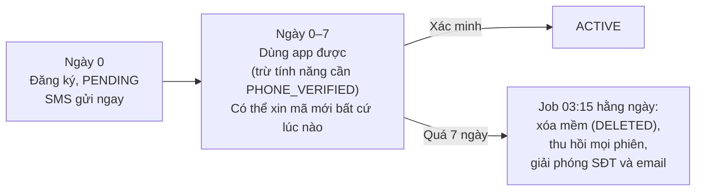

- Job xử lý tối đa 500 tài khoản mỗi lần chạy; phần còn lại để lần sau.
- Trước khi vô hiệu hóa, job kiểm tra lại: nếu người dùng vừa xác minh thì bỏ qua.
- **Chưa có tin nhắn nhắc nhở** trước khi vô hiệu hóa.
- Sau khi bị vô hiệu hóa, đăng nhập bằng số đó trả 401 `Incorrect username or password.` (tài khoản coi như không tồn tại). Người dùng phải đăng ký lại.
- Tài khoản tạo trước khi có tính năng xác minh vẫn ở `ACTIVE` và **không** bị ảnh hưởng.

---

## 5. ĐĂNG NHẬP

### 5.1. Mục tiêu

- Xác thực bằng **số điện thoại + mật khẩu**, mở **một phiên mới** cho thiết bị đang dùng.
- Không cho biết số điện thoại nào đã đăng ký (cùng một message cho "không tồn tại" và "sai mật khẩu").
- Chống dò mật khẩu: khóa tạm theo **tài khoản** + rate limit theo **IP**.
- Tài khoản `PENDING` vẫn đăng nhập được, để vào app nhập mã xác minh.

### 5.2. Hành trình người dùng

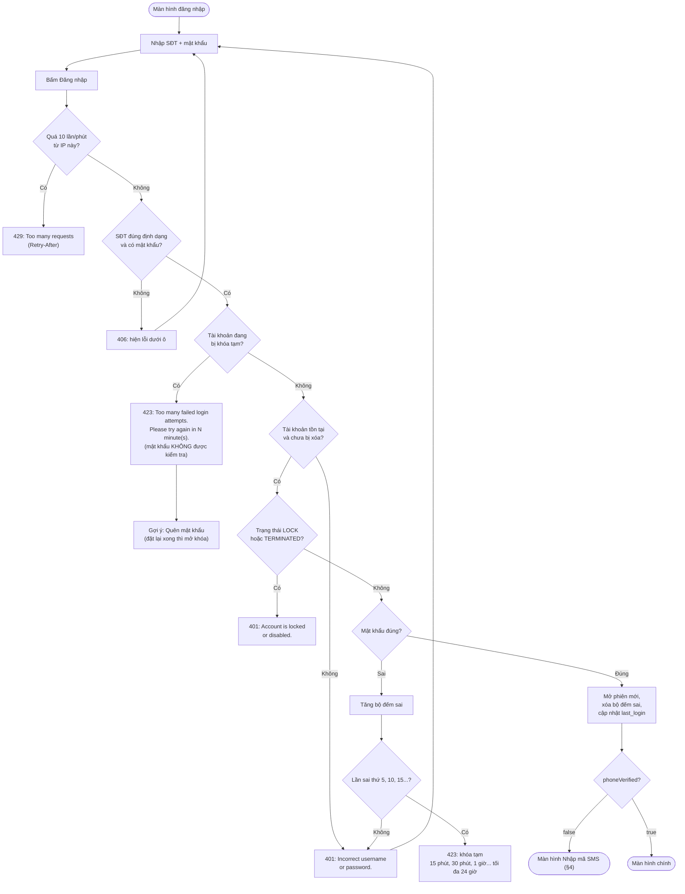

### 5.3. Thứ tự xử lý phía server

1. **Rate limit theo IP**: 10 lần / phút. Vượt thì 429, không xử lý gì thêm.
2. **Định dạng (406)**: `username` bắt buộc, 10–12 chữ số; `password` bắt buộc (khác `null`). Đăng nhập **không** kiểm tra độ mạnh mật khẩu. Mật khẩu là chuỗi rỗng `""` vẫn qua bước này và bị tính là một lần sai mật khẩu.
3. **Tìm tài khoản** theo số điện thoại (bỏ qua tài khoản đã xóa mềm).
4. **Khóa tạm?** Nếu tài khoản tồn tại và đang trong thời gian khóa (`locked_until` > hiện tại):
   - trả **423** + `Retry-After` ngay, **không kiểm tra mật khẩu** (đoán trúng trong lúc khóa cũng vô ích);
   - lần thử này **không** được đếm; ghi audit `LOGIN_BLOCKED`.
5. **Xác thực qua Spring Security**, theo thứ tự:
   1. Không tìm thấy tài khoản → lỗi sai thông tin (401 `Incorrect username or password.`). Không có gì để đếm; rate limit IP lo phần này.
   2. Trạng thái `LOCK` / `TERMINATED` → 401 `Account is locked or disabled.` (kiểm tra **trước** mật khẩu, không đếm).
   3. So mật khẩu với hash BCrypt. Sai → bước 6.
6. **Sai mật khẩu**:
   - ghi audit `LOGIN_FAILED`;
   - tăng `failed_login_attempts` bằng một câu `UPDATE` nguyên tử (nhiều request song song không ghi đè nhau);
   - nếu số lần sai là bội số của 5 → đặt `locked_until`, ghi audit `ACCOUNT_TEMPORARILY_LOCKED`, trả **423**; ngược lại trả **401**;
   - bộ đếm và khóa được **lưu dù request trả lỗi**.
7. **Đúng mật khẩu** → mở phiên (`loginInternal`):
   1. Cấp access token (kiểm tra lại trạng thái lần cuối; không bao giờ cấp cho tài khoản bị khóa/vô hiệu).
   2. Tạo phiên mới: refresh token ngẫu nhiên 256-bit, chỉ lưu SHA-256; ghi User-Agent và IP để truy vết (không dùng để chặn).
   3. Ghi `last_login`, **xóa bộ đếm sai và khóa tạm**.
   4. Ghi audit `LOGIN_SUCCEEDED`.
8. **Trả về** HTTP 200 + 2 cookie + `LoginResponse` (cùng định dạng với đăng ký, `message = "User logged in successfully."`).

### 5.4. Luồng xử lý phía server

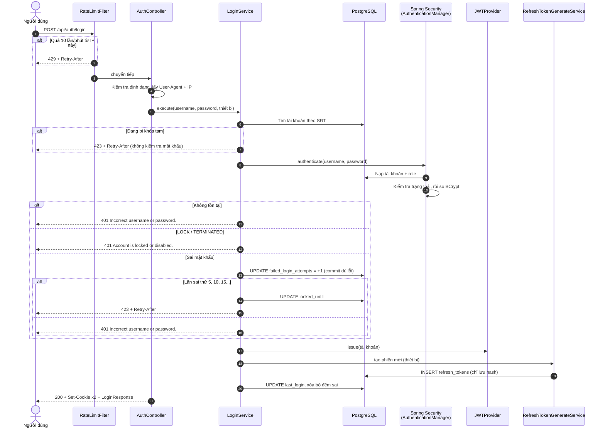

### 5.5. Khóa tạm lũy tiến: ví dụ cụ thể

Một tài khoản bị đoán mật khẩu liên tục, **không lần nào đăng nhập đúng**:

| Lần sai thứ | Kết quả | Khóa tới |
|---|---|---|
| 1 – 4 | 401 `Incorrect username or password.` | — |
| 5 | **423**, khóa 15 phút | +15 phút |
| (trong 15 phút) | 423 ngay, không kiểm tra mật khẩu, **không đếm** | — |
| 6 – 9 (sau khi hết khóa) | 401 | — |
| 10 | **423**, khóa 30 phút | +30 phút |
| 15 | 423, khóa 1 giờ | +1 giờ |
| 20 | 423, khóa 2 giờ | +2 giờ |
| 25 | 423, khóa 4 giờ | +4 giờ |
| 30 | 423, khóa 8 giờ | +8 giờ |
| 35 | 423, khóa 16 giờ | +16 giờ |
| 40, 45, ... | 423, khóa **24 giờ** (mức trần) | +24 giờ |

- Hết thời gian khóa thì bộ đếm **không** quay về 0; nó chỉ về 0 khi **đăng nhập đúng** hoặc **đặt lại mật khẩu qua OTP**.
- Message 423 làm tròn lên theo phút: `Please try again in 15 minute(s).` Header `Retry-After` tính bằng giây.
- Khóa tạm **không** đăng xuất các phiên đang mở, để kẻ đoán mật khẩu không thể "đá" người dùng thật ra khỏi app.
- Người dùng thật đang bị khóa tạm có thể: chờ, hoặc **quên mật khẩu** (đặt lại thành công thì mở khóa ngay), hoặc nếu đang đăng nhập ở thiết bị khác thì **đổi mật khẩu** bình thường.

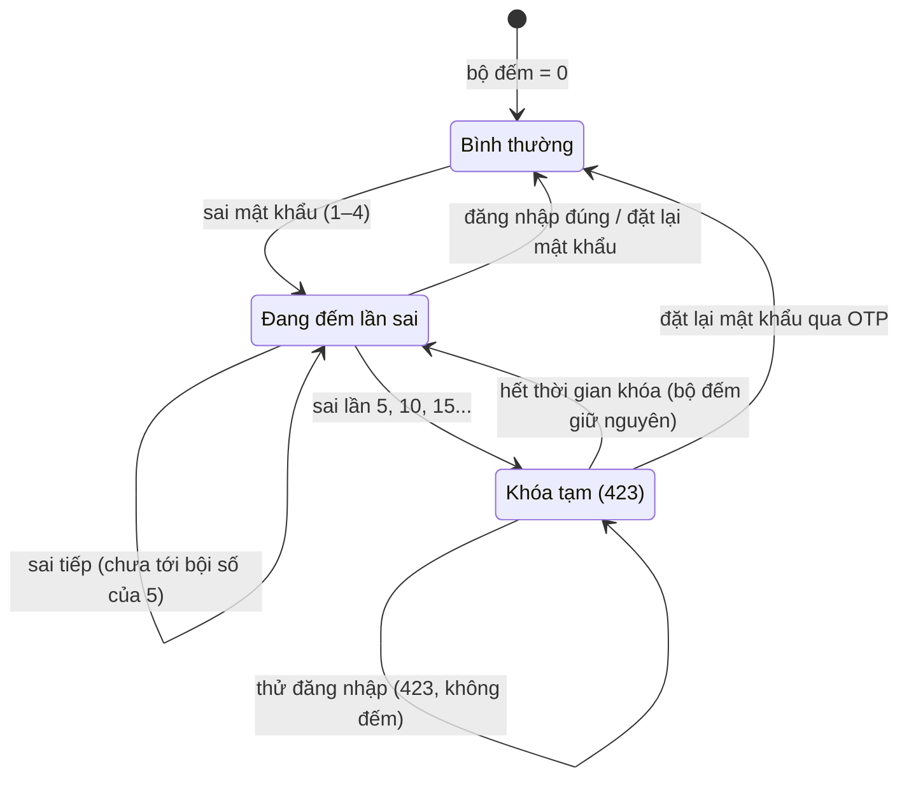

### 5.6. Các tình huống nghiệp vụ

| Tình huống | Kết quả |
|---|---|
| Đăng nhập trên 2 thiết bị | 2 phiên độc lập; đăng xuất máy này không ảnh hưởng máy kia |
| Tài khoản `PENDING` đăng nhập | Thành công, `phoneVerified = false` → app chuyển sang màn hình nhập mã |
| Tài khoản bị vô hiệu hóa sau 7 ngày | 401 `Incorrect username or password.` → phải đăng ký lại |
| Tài khoản bị quản trị viên khóa | 401 `Account is locked or disabled.`, kể cả khi mật khẩu sai |
| Nhập SĐT có dấu cách hoặc `+84...` | 406 (chỉ chấp nhận 10–12 chữ số liền) |
| Đúng mật khẩu nhưng đang bị khóa tạm | 423; phải chờ hoặc quên mật khẩu |
| Đăng nhập lại khi đang có phiên trên chính thiết bị đó | Tạo thêm một phiên mới; phiên cũ vẫn sống tới khi hết hạn (cookie cũ bị ghi đè nên thực tế không dùng nữa) |

### 5.7. Bảng lỗi đăng nhập (cho frontend)

| HTTP | Message | Gợi ý hiển thị |
|---|---|---|
| 406 | `Validation failed.` + lỗi theo field | Lỗi dưới ô nhập |
| 401 | `Incorrect username or password.` | "Số điện thoại hoặc mật khẩu không đúng" + link Quên mật khẩu |
| 401 | `Account is locked or disabled.` | "Tài khoản đã bị khóa, vui lòng liên hệ hỗ trợ" |
| 423 | `Too many failed login attempts. Please try again in N minute(s).` | Đếm ngược theo `Retry-After` + link Quên mật khẩu |
| 429 | `Too many requests. Please try again later.` | Đếm ngược theo `Retry-After` |

---

## 6. SAU KHI ĐĂNG NHẬP: GỌI API, TỰ GIA HẠN PHIÊN, ĐĂNG XUẤT

### 6.1. Client giữ gì

| | Access token | Refresh token |
|---|---|---|
| Ở đâu | Body (`result.accessToken`) **và** cookie `cookie-jwt` (`Path=/`) | **Chỉ** cookie `cookie-jwt-rf` (`Path=/api/auth`), không bao giờ trong body |
| Sống | 15 phút | Không dùng 7 ngày thì hết; tối đa 30 ngày kể từ đăng nhập |
| Dùng để | Gọi API: header `Authorization: Bearer <token>` (mobile/SPA) hoặc cookie (trình duyệt) | Chỉ để gia hạn (`/refresh-token`) hoặc đăng xuất (`/logout`) |

Cả hai cookie đều `HttpOnly` (JavaScript không đọc được), `Secure` (chỉ qua HTTPS) và `SameSite=Strict`.

### 6.2. Mỗi request gọi API

Với mọi endpoint cần đăng nhập, server:
1. Lấy access token (ưu tiên header `Authorization`, sau đó cookie).
2. Kiểm tra chữ ký và hạn. Không hợp lệ thì request coi như chưa đăng nhập → 401.
3. **Nạp lại tài khoản từ DB** và chỉ chấp nhận khi: tài khoản còn tồn tại, đúng ID ghi trong token (số điện thoại đăng ký lại cho người khác thì token cũ vô dụng), không bị `LOCK` / `TERMINATED` / `DELETED`.
4. Quyền lấy từ DB tại thời điểm đó, không lấy từ token.

### 6.3. Tự gia hạn phiên và đăng xuất

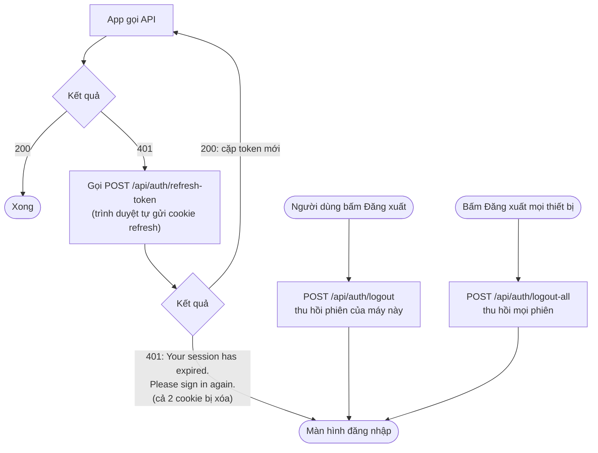

Quy tắc chính (chi tiết ở [03](03_AUTH_REFRESH_TOKEN_FLOW.md)):
- Mỗi lần gia hạn, refresh token cũ bị "dùng hết" và được thay bằng token mới (rotation).
- Hai tab/request gia hạn gần như cùng lúc (trong 30 giây) đều thành công.
- Một refresh token đã dùng mà xuất hiện lại sau 30 giây bị coi là **bị đánh cắp**: toàn bộ phiên đó bị thu hồi.
- Gia hạn thất bại vì bất kỳ lý do gì đều trả cùng một message, và xóa cả hai cookie.
- Đăng xuất **không cần access token còn hạn** và gọi nhiều lần không lỗi.
- Sau khi phiên bị thu hồi (đăng xuất, đổi mật khẩu), access token đã cấp vẫn dùng được **tối đa 15 phút** cho tới khi hết hạn. Riêng khóa tài khoản thì có hiệu lực ngay (§6.2).

---

## 7. QUÊN MẬT KHẨU VÀ ĐỔI MẬT KHẨU

### 7.1. Quên mật khẩu: hai kênh

| | Qua SMS | Qua email |
|---|---|---|
| Endpoint bước 1 | `POST /api/auth/forgot-password/sms` `{"phoneNumber"}` | `POST /api/auth/forgot-password` `{"email"}` |
| Ai dùng được | Mọi tài khoản không bị khóa/vô hiệu, **kể cả `PENDING`** | Chỉ tài khoản có **email đã xác minh** |
| Mã OTP | 6 số, 15 phút, gửi qua SMS | 6 số, 15 phút, gửi qua email kèm link chứa reset token |
| Reset token | Trả trong response | **Không** trả trong response; chỉ nằm trong link của email |
| Thành công thì | SĐT được đánh dấu đã xác minh (`PENDING` → `ACTIVE`) + SMS báo đã đổi | Email báo đã đổi |

Quy tắc chung của bước 1:
- **Luôn trả cùng một câu trả lời** dù số/email có tồn tại, bị khóa, chưa xác minh hay không. Kênh SMS luôn trả kèm một `resetToken` (token giả nếu không có gì được gửi).
- **Cooldown 60 giây** mỗi số/email: xin lại trong 60 giây thì không gửi thêm; câu trả lời vẫn giống hệt (token giả, hạn mới). App phải **giữ `resetToken` của lần gửi đầu tiên**.
- Tối đa **5 mã / ngày** mỗi số/email. Gửi mã mới thì mã cũ bị hủy.

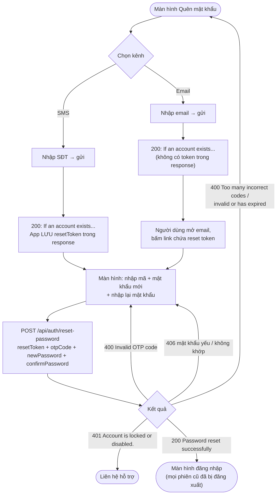

Bước 2 (`/reset-password`):
- Mật khẩu mới theo cùng quy tắc như khi đăng ký (§3.3).
- Mỗi reset token chịu tối đa **5 lần nhập sai mã**; lần thứ 5 hủy token. Số lần sai được lưu dù request lỗi.
- Thành công thì: đổi mật khẩu; **mở khóa tạm** (§5.5); **thu hồi mọi phiên** trên mọi thiết bị; **không** đăng nhập sẵn (response xóa cookie) — người dùng đăng nhập lại bằng mật khẩu mới.

### 7.2. Lấy lại số điện thoại bị người khác đăng ký

Đây là lý do nghiệp vụ chính của kênh SMS: xem hành trình ở §8.3.

### 7.3. Đổi mật khẩu (đang đăng nhập)

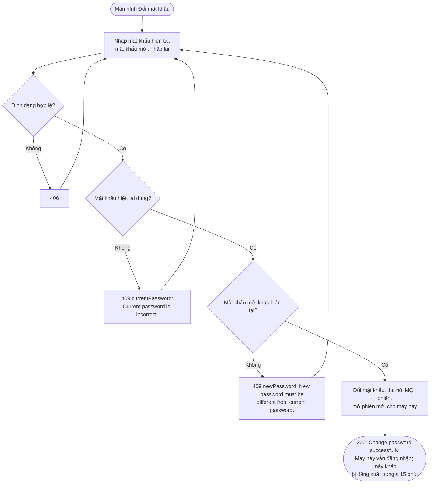

- Phiên mới của máy hiện tại được mở **không qua đăng nhập bằng mật khẩu**, nên đổi mật khẩu vẫn thành công kể cả khi tài khoản đang bị khóa tạm do người khác đoán mật khẩu.
- Sai mật khẩu hiện tại được ghi audit `PASSWORD_CHANGE_FAILED` nhưng **không** tính vào bộ đếm khóa tạm của đăng nhập.

---

## 8. HÀNH TRÌNH ĐẦU-CUỐI TIÊU BIỂU

### 8.1. Người dùng mới, xác minh ngay

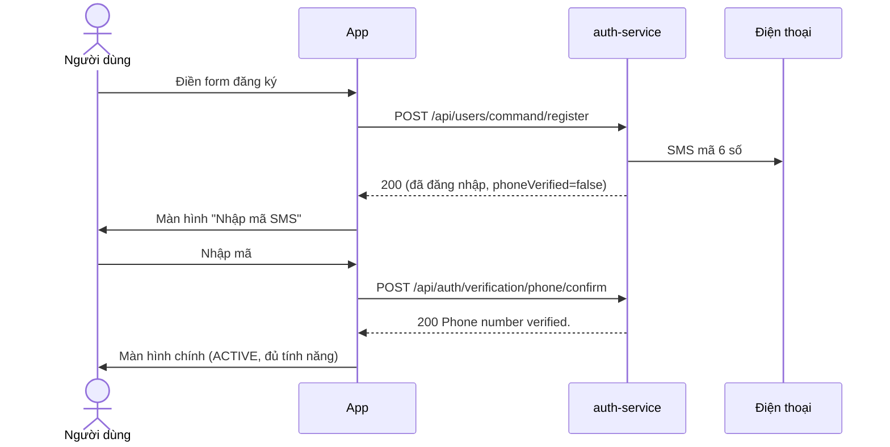

### 8.2. Người dùng mới, để xác minh sau

1. Đăng ký → vào app với tài khoản `PENDING`. Tính năng cần `PHONE_VERIFIED` bị chặn khi các module áp dụng (hiện chưa module nào áp dụng; xem §10.2 về mã lỗi).
2. Mã SMS đầu tiên hết hạn sau 10 phút. Khi muốn xác minh, người dùng bấm "Gửi lại mã" rồi nhập mã mới.
3. Nếu sau 7 ngày vẫn chưa xác minh: tài khoản bị vô hiệu hóa, mọi phiên bị thu hồi, số điện thoại được giải phóng. Request kế tiếp của app nhận 401 ngay (tài khoản đã xóa không qua được bước kiểm tra mỗi request), gia hạn phiên cũng thất bại, app về màn hình đăng nhập. Muốn dùng tiếp phải đăng ký lại từ đầu.

### 8.3. Số điện thoại bị người khác đăng ký trước

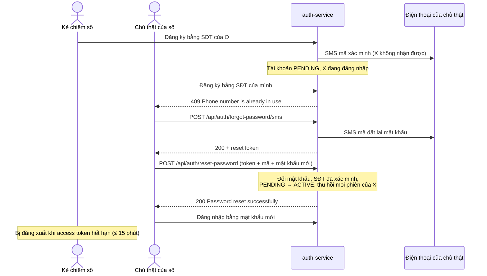

Lưu ý: tài khoản lấy lại vẫn giữ **họ tên, email (chưa xác minh) và CCCD do kẻ chiếm số nhập** (xem §10, câu hỏi mở).

### 8.4. Quên mật khẩu khi đang bị khóa tạm

1. Sai mật khẩu 5 lần → 423, khóa 15 phút.
2. Bấm "Quên mật khẩu" → SMS → nhập mã + mật khẩu mới → 200.
3. Khóa tạm được gỡ, bộ đếm về 0 → đăng nhập ngay bằng mật khẩu mới.

### 8.5. Không mở app 8 ngày (tài khoản đã xác minh)

1. Refresh token đã quá hạn idle 7 ngày.
2. App gọi API → 401 → gọi `/refresh-token` → 401 `Your session has expired. Please sign in again.` (cookie bị xóa).
3. App về màn hình đăng nhập. Tài khoản không bị ảnh hưởng.

### 8.6. Mất điện thoại

1. Từ máy khác: đăng nhập → **Đổi mật khẩu** (đăng xuất mọi máy khác) hoặc **Đăng xuất mọi thiết bị**.
2. Máy bị mất còn dùng được tối đa 15 phút (access token đang có), sau đó không gia hạn được.

---

## 9. THAM SỐ NGHIỆP VỤ

Giá trị hiện tại trong `application.yml`; đổi được không cần sửa code.

| Nhóm | Tham số | Giá trị |
|---|---|---|
| Token | Hạn access token (`app.jwt.expiration.minutes`) | 15 phút |
| Token | Hạn idle của phiên (`app.jwt.jwtRefreshExpirationMs`) | 7 ngày |
| Token | Hạn tuyệt đối của phiên (`app.jwt.refreshAbsoluteExpirationMs`) | 30 ngày |
| Token | Grace period khi gia hạn trùng (`app.jwt.refreshReuseGraceSeconds`) | 30 giây |
| Đăng nhập | Số lần sai trước mỗi lần khóa (`app.security.login.max-failed-attempts`) | 5 |
| Đăng nhập | Khóa lần đầu / tối đa (`lock-duration` / `max-lock-duration`) | 15 phút / 24 giờ |
| Xác minh | Hiệu lực mã / số lần sai / cooldown / mã mỗi ngày | 10 phút / 5 / 60 giây / 5 |
| Xác minh | Thời gian chờ xác minh SĐT trước khi vô hiệu hóa (`pending-account-ttl`) | 7 ngày (job 03:15) |
| Đặt lại mật khẩu | Hiệu lực mã | 15 phút (cố định trong code, `PasswordResetToken.LIFETIME`) |
| Đặt lại mật khẩu | Số lần sai / cooldown / mã mỗi ngày | 5 / 60 giây / 5 |
| Rate limit | Theo endpoint (§1.3) | `app.security.rate-limit.rules` |
| Nhật ký | Thời gian giữ audit log | 180 ngày (job 04:00) |

---

## 10. ĐIỂM CẦN LƯU Ý VÀ CÂU HỎI MỞ

Những điểm dưới đây là hành vi **thực tế của code hiện tại**, cần product owner quyết định hoặc cần làm tiếp:

### 10.1. Cần quyết định nghiệp vụ

1. **Dữ liệu của kẻ chiếm số còn lại sau khi chủ thật lấy lại tài khoản** (§8.3): họ tên, email chưa xác minh và **CCCD** của người kia vẫn gắn với tài khoản. CCCD đó cũng bị "chiếm chỗ" (không ai đăng ký được bằng CCCD đó nữa). Đề xuất: khi xác minh SĐT qua reset SMS mà tài khoản đang `PENDING`, xóa email chưa xác minh và CCCD, yêu cầu nhập lại họ tên.
2. **Tài khoản `PENDING` được phép làm gì**: chưa module nào chặn bằng `PHONE_VERIFIED`. Cần danh sách hành động bắt buộc xác minh (đặt phòng, đăng tin, thanh toán, ...).
3. **Thông báo khi tài khoản đã bị vô hiệu hóa vì không xác minh**: người dùng chỉ thấy "Sai số điện thoại hoặc mật khẩu". Có nên nhắc trước (SMS ngày thứ 5) hoặc báo rõ hơn không?
4. **Tài khoản bị `LOCK` lộ trạng thái**: thông báo `Account is locked or disabled.` hiện ra **kể cả khi mật khẩu sai**, nên ai cũng biết được một số điện thoại đang bị khóa.
5. **HTTP 200 nhưng `code: 201`** ở đăng ký; có nên trả HTTP 201 thật không (cần thống nhất với frontend).

### 10.2. Hạn chế kỹ thuật ảnh hưởng người dùng

1. **Link trong email đặt lại mật khẩu là link giả** (`https://yourapp.com/reset-password?token=...`). Vì reset token chỉ nằm trong link đó, **luồng quên mật khẩu qua email hiện chưa dùng được đầu-cuối** cho tới khi có URL frontend thật. Kênh SMS không bị ảnh hưởng.
2. **Chưa có nhà cung cấp SMS thật**: bản dev chỉ ghi SMS ra log. Production không khởi động được cho tới khi gắn nhà cung cấp.
3. **SMS gửi trước khi lưu xong**: nếu đăng ký thất bại ở bước cuối (hiếm, ví dụ hai request đăng ký cùng số chạy đồng thời), người dùng vẫn có thể nhận SMS mã xác minh của một tài khoản không tồn tại.
4. **Đăng ký đồng thời trùng số** trả 500 thay vì 409 (ràng buộc duy nhất trong DB chặn bản ghi thứ hai).
5. **Gửi SMS/email đồng bộ**: nhà cung cấp chậm thì đăng ký / quên mật khẩu chậm theo; thời gian phản hồi cũng có thể để lộ email/số nào có tài khoản.
6. **Rate limit đếm trong bộ nhớ từng instance**; chạy nhiều instance sau load balancer cần chuyển sang Redis. Sau reverse proxy phải cấu hình `server.forward-headers-strategy`, nếu không mọi người dùng chung một IP (và chung một hạn mức).
7. **Chưa có API**: cập nhật hồ sơ, thêm/đổi email, quản trị viên khóa/mở khóa tài khoản, xem danh sách phiên đang mở.
8. **Token đã cấp sống tới 15 phút** sau khi đăng xuất / đổi mật khẩu (thiết kế chấp nhận được, nhưng cần biết).
9. **Không có job dọn bảng `password_reset_token`**: bảng tăng dần theo số lần quên mật khẩu.
10. **Mã lỗi khi bị chặn bởi `@PreAuthorize` (cần kiểm tra trước khi áp dụng `PHONE_VERIFIED`)**: `GlobalServerExceptionHandler` (module `common`) có handler bắt mọi `Exception`. `AccessDeniedException` do `@PreAuthorize` ném ra bên trong controller/service nhiều khả năng bị handler này bắt và trả **500** thay vì 403 (`accessDeniedHandler` trong `SecurityConfig` chỉ áp dụng cho chặn theo URL). Nên thêm handler riêng trả 403 cho `AccessDeniedException`.

---

## 11. QUY TẮC NẰM Ở ĐÂU TRONG CODE

Đường dẫn gốc: `modules/auth-service/src/main/java/vn/sunvibe/auth/core/`.

| Quy tắc | Lớp |
|---|---|
| Rate limit theo IP | `infrastructure/security/ratelimit/RateLimitFilter`, `TokenBucketRateLimiter`; luật trong `application.yml` |
| Định dạng form đăng ký / đăng nhập | `presentation/dto/request/user/UserRegisterRequest`, `presentation/dto/request/auth/LoginRequest` |
| Quy tắc mật khẩu mạnh (8–72) | `presentation/validation/user/validator/StrongPasswordValidator` |
| Kiểm tra trùng, tạo tài khoản, đăng nhập sau đăng ký | `application/usecase/user/impl/UserRegisterService` |
| Trạng thái ban đầu, chuyển trạng thái, quyền đăng nhập | `domain/model/user/aggregate/AppUser` (`create`, `verifyPhone`, `canAuthenticate`, `isLoginTemporarilyLocked`, `deactivate`) |
| Định dạng SĐT / email / CCCD | `domain/model/user/vo/Username`, `Email`, `IdCardNumber` |
| Đăng nhập, khóa tạm, mở phiên | `application/usecase/user/impl/LoginService`, `application/shared/LoginLockoutPolicy` |
| Kiểm tra trạng thái khi đăng nhập | `infrastructure/security/userdetails/CustomUserDetails`, `infrastructure/security/provider/CustomUserDetailsService` |
| Cấp / kiểm tra access token | `infrastructure/security/provider/JWTProvider` |
| Kiểm tra mỗi request | `infrastructure/security/filter/JWTRequestFilter` |
| Phiên, gia hạn, đăng xuất | `application/usecase/auth/impl/RefreshTokenGenerateService`, `TokenRefreshService`, `LogoutService` |
| Mã xác minh SĐT / email | `application/usecase/auth/impl/ContactVerificationService`, `application/shared/VerificationPolicy`, `domain/model/auth/VerificationCode` |
| Vô hiệu hóa tài khoản không xác minh | `application/usecase/user/impl/PendingAccountCleanupService`, `presentation/scheduler/PendingAccountCleanupScheduler` |
| Quên / đặt lại / đổi mật khẩu | `application/usecase/auth/impl/PasswordForgotService`, `PasswordResetService`, `application/usecase/user/impl/PasswordChangeService` |
| Mã lỗi HTTP | `presentation/exception/AuthExceptionHandler` (400/401/404/423/429), `GlobalServerExceptionHandler` ở module `common` (406/409) |
| Cookie | `shared/service/CookieService` |
| Endpoint public | `SecurityConfig` ở module `app` |
