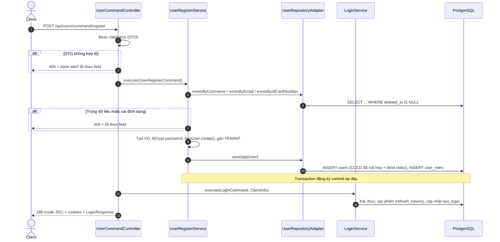

# 01. ĐẶC TẢ NGHIỆP VỤ ĐĂNG KÝ TÀI KHOẢN (USER REGISTRATION)
## Module `auth-service` · Endpoint `POST /api/users/command/register`

---

## 1. MỤC TIÊU & PHẠM VI

Cho phép người dùng tự tạo tài khoản bằng **số điện thoại + mật khẩu**, với ít thông tin nhất có thể, rồi **đăng nhập luôn** để vào app mà không phải nhập lại.

| Hạng mục | Quy định |
|---|---|
| Thông tin bắt buộc | `fullName`, `username` (số điện thoại), `password`, `confirmPassword` |
| Thông tin tùy chọn | `email`, `idCardNumber` (CMND/CCCD). Có thể bổ sung sau qua chức năng cập nhật hồ sơ (chưa triển khai) |
| Vai trò (role) | Luôn là `TENANT`. Client không chọn được role; các role khác do luồng riêng cấp |
| Kết quả | Tài khoản `ACTIVE`, KYC `UNVERIFIED`, kèm phiên đăng nhập mới (access token + refresh token) |

Ngoài phạm vi: xác minh số điện thoại bằng OTP, xác minh email, eKYC.

---

## 2. API

### 2.1. Request

```http
POST /api/users/command/register
Content-Type: application/json
```

```json
{
  "fullName": "Nguyễn Văn An",
  "username": "0912345678",
  "password": "Str0ng@Pass",
  "confirmPassword": "Str0ng@Pass",
  "email": "an.nguyen@example.com",
  "idCardNumber": "079123456789"
}
```

| Trường | Bắt buộc | Ràng buộc | Ghi chú |
|---|---|---|---|
| `fullName` | Có | 6–100 ký tự | |
| `username` | Có | `^[0-9]{10,12}$` | Số điện thoại, dùng làm tên đăng nhập |
| `password` | Có | ≥ 8 ký tự, có chữ hoa, chữ thường, chữ số và ký tự đặc biệt trong `@$!%*?&`; chỉ gồm chữ, số và các ký tự đặc biệt đó | `@StrongPassword` |
| `confirmPassword` | Có | Phải trùng `password` | `@ConfirmPasswordMatch` |
| `email` | Không | ≤ 100 ký tự, đúng định dạng email | Bỏ trống, `null` hoặc chỉ có khoảng trắng đều coi là *không cung cấp* |
| `idCardNumber` | Không | 9 số (CMND) hoặc 12 số (CCCD) | Chuỗi rỗng coi là *không cung cấp* |

Request **không có** trường `roles`; nếu client gửi kèm thì bị bỏ qua.

### 2.2. Response thành công

HTTP `200 OK`, body `code = 201`, kèm 2 cookie (xem [02_AUTH_LOGIN_FLOW.md](02_AUTH_LOGIN_FLOW.md) §2.2):

```http
Set-Cookie: cookie-jwt=<access token>; Path=/; Max-Age=900; Secure; HttpOnly; SameSite=Strict
Set-Cookie: cookie-jwt-rf=<refresh token>; Path=/api/auth; Max-Age=604800; Secure; HttpOnly; SameSite=Strict
```

```json
{
  "code": 201,
  "message": "User registered successfully.",
  "result": {
    "tokenType": "JWT",
    "accessToken": "eyJ0eXAiOiJKV1Qi...",
    "expiresIn": 900,
    "username": "0912345678",
    "userEmail": "an.nguyen@example.com",
    "roles": ["TENANT"],
    "message": "User logged in successfully."
  }
}
```

`userEmail` là `null` khi người dùng không nhập email.

---

## 3. LUỒNG XỬ LÝ



### 3.1. Kiểm tra mức DTO (presentation)

Các annotation trên `UserRegisterRequest` chạy trước khi vào service. Khi lỗi, `GlobalServerExceptionHandler` trả **406 Not Acceptable**:

```json
{
  "message": "Validation failed.",
  "errors": [
    { "field": "confirmPassword", "message": "Confirm password must match password." }
  ]
}
```

### 3.2. Kiểm tra nghiệp vụ (`UserRegisterService`)

Kiểm tra theo đúng thứ tự dưới đây và dừng ở lỗi đầu tiên:

1. **Số điện thoại đã được dùng?** `existsByUsername`. Trùng thì trả lỗi `username`: *"Phone number is already in use."*
2. **Email** (chỉ khi có cung cấp):
   - Cắt khoảng trắng, kiểm tra định dạng (`Email.create`), rồi chuyển về chữ thường.
   - Sai định dạng: lỗi `email` *"Invalid email format."*
   - Đã được dùng: lỗi `email` *"Email is already in use."*
3. **CMND/CCCD** (chỉ khi có cung cấp):
   - Cắt khoảng trắng, kiểm tra định dạng (`IdCardNumber.create`).
   - Kiểm tra trùng qua blind index (xem §4.2). Trùng thì lỗi `idCardNumber`.

Lỗi nghiệp vụ là `AuthValidationException` và được trả **409 Conflict**, cùng định dạng body như §3.1.

Mọi phép kiểm tra trùng **bỏ qua tài khoản đã xóa mềm** (`deleted_at IS NOT NULL`). Vì vậy số điện thoại, email hoặc CCCD của tài khoản đã xóa có thể dùng lại để đăng ký mới.

### 3.3. Tạo tài khoản

| Thuộc tính | Giá trị |
|---|---|
| `id` | ULID 26 ký tự (`IdGenerator<String>`) |
| `password` | BCrypt, cost 10. Không bao giờ lưu mật khẩu gốc |
| `profile_image` | Ảnh mặc định (`ProfileImage.create(null)`) |
| `user_status` | `ACTIVE` |
| `kyc_status` | `UNVERIFIED` |
| Role | `TENANT` (`appUser.assignRole(RoleName.TENANT)`) |
| `created_date`, `last_update` | Thời điểm hiện tại (UTC) |

### 3.4. Đăng nhập tự động

Sau khi transaction đăng ký commit, controller gọi `LoginService.execute()` với chính số điện thoại và mật khẩu vừa nhập. Toàn bộ phần này giống hệt luồng đăng nhập ([02_AUTH_LOGIN_FLOW.md](02_AUTH_LOGIN_FLOW.md)): xác thực, cấp access token, **mở phiên mới** (refresh token family) gắn với User-Agent/IP của thiết bị, và cập nhật `last_login`.

Đăng ký và đăng nhập là **hai transaction riêng**. Nếu bước đăng nhập lỗi, tài khoản vẫn đã được tạo và người dùng chỉ cần đăng nhập lại.

---

## 4. LƯU TRỮ DỮ LIỆU

### 4.1. Bảng liên quan

- `users`: một dòng cho tài khoản mới.
- `user_roles`: liên kết với role `TENANT`.
- `refresh_tokens`: phiên đăng nhập do bước đăng nhập tự động tạo.

DDL chi tiết: [DATABASE_SCHEMA_POSTGRESQL.md](../database/DATABASE_SCHEMA_POSTGRESQL.md).

Tính duy nhất được đảm bảo bởi các **partial unique index** chỉ áp cho tài khoản chưa xóa:

```sql
CREATE UNIQUE INDEX idx_users_username ON users (username) WHERE deleted_at IS NULL;
CREATE UNIQUE INDEX idx_users_email ON users (email) WHERE deleted_at IS NULL;
CREATE UNIQUE INDEX idx_users_id_card_number_hash ON users (id_card_number_hash) WHERE deleted_at IS NULL;
```

### 4.2. Bảo vệ số CMND/CCCD

Số CCCD là dữ liệu cá nhân nhạy cảm nên không bao giờ lưu dạng rõ:

| Cột | Nội dung | Khóa |
|---|---|---|
| `id_card_number` | Bản mã AES-256-GCM (IV ngẫu nhiên mỗi lần mã hóa) | `ID_CARD_CRYPTO_KEY` |
| `id_card_number_hash` | HMAC-SHA256 của số CCCD (blind index), dùng để kiểm tra trùng mà không cần giải mã | `ID_CARD_CRYPTO_INDEX_KEY` |

- Hai khóa phải là chuỗi base64 của đúng 32 byte và phải khác nhau.
- Thiếu khóa thì ứng dụng **không khởi động được** (fail-fast).
- Profile `dev`/`test` có sẵn khóa công khai, chỉ dùng cho môi trường phát triển.
- Khi người dùng không nhập CCCD, cả hai cột đều là `NULL`.

---

## 5. BẢNG LỖI

| Tình huống | HTTP | Field | Message |
|---|---|---|---|
| Thiếu `fullName`/`username`/`password`/`confirmPassword` | 406 | tương ứng | `... is mandatory.` |
| Số điện thoại sai định dạng | 406 | `username` | Phone numbers must be between 10 and 12 digits. |
| Mật khẩu yếu | 406 | `password` | Password must be at least 8 characters. / Password must contain uppercase, lowercase, number and special character. |
| `confirmPassword` khác `password` | 406 | `confirmPassword` | Confirm password must match password. |
| CCCD sai định dạng | 406 | `idCardNumber` | ID card number must be a 9-digit CMND or 12-digit CCCD. |
| Số điện thoại đã dùng | 409 | `username` | Phone number is already in use. |
| Email sai định dạng | 409 | `email` | Invalid email format. |
| Email đã dùng | 409 | `email` | Email is already in use. |
| CCCD đã dùng | 409 | `idCardNumber` | ID card number is already in use. |

---

## 6. THÀNH PHẦN MÃ NGUỒN

| Tầng | Lớp |
|---|---|
| Presentation | `UserCommandController`, `UserRegisterRequest`, `UserConverter`, `AuthConverter.toClientInfo` |
| Application | `UserRegisterUseCase` / `UserRegisterService`, `UserRegisterCommand`, `LoginUseCase` |
| Domain | `AppUser.create()`, VO `Username`, `Email`, `Password`, `IdCardNumber`, `ProfileImage`, `UserId` |
| Infrastructure | `UserRepositoryAdapter`, `UserJpaRepository`, `UserEntity`, `EncryptedStringAttributeConverter`, `AesGcmCryptoService` (module `common`) |
| Migration | `V202610091201__create_users_table.sql`, `V202610091202__create_user_roles_table.sql`, `V202610091300__make_user_id_card_optional.sql` |

Test: `UserRegisterServiceTest`, `IdCardNumberTest`, `UserRepositoryAdapterEncryptionTest`, `UserJpaRepositorySoftDeleteTest`.

---

## 7. HẠN CHẾ ĐÃ BIẾT

1. **Đăng ký đồng thời trùng số điện thoại**: hai request cùng lúc có thể cùng vượt qua bước kiểm tra trùng. Unique index chặn được bản ghi thứ hai, nhưng lỗi trả về là **500** thay vì 409.
2. **Chưa xác minh số điện thoại**: chưa có OTP SMS, nên ai cũng có thể đăng ký bằng số của người khác.
3. **Mã HTTP**: thành công trả HTTP `200`, còn trong body là `code: 201`.
4. **Quên mật khẩu** hiện chỉ đi qua email. Tài khoản đăng ký không có email sẽ chưa dùng được chức năng này.
5. Message của `fullName` ghi "From 6 to 32 characters" trong khi ràng buộc thực tế là 6–100 ký tự.
