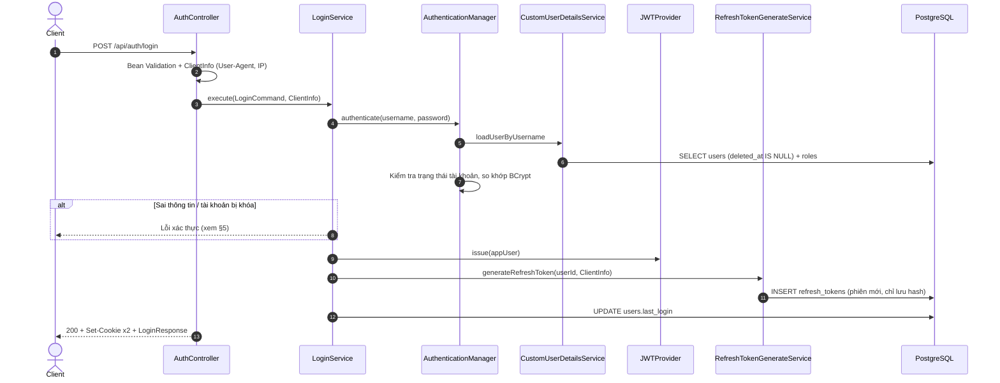

# 02. ĐẶC TẢ NGHIỆP VỤ ĐĂNG NHẬP (LOGIN)
## Module `auth-service` · Endpoint `POST /api/auth/login`

---

## 1. MỤC TIÊU & PHẠM VI

Xác thực người dùng bằng **số điện thoại + mật khẩu** và mở một **phiên đăng nhập** cho thiết bị đang dùng.

Kết quả đăng nhập gồm hai token:
- **Access token** (JWT, sống 15 phút): dùng để gọi API.
- **Refresh token** (sống tối đa 30 ngày): dùng để xin access token mới mà không phải đăng nhập lại. Xem [03_AUTH_REFRESH_TOKEN_FLOW.md](03_AUTH_REFRESH_TOKEN_FLOW.md).

Mỗi lần đăng nhập tạo một **phiên độc lập**. Người dùng có thể đăng nhập đồng thời trên nhiều thiết bị; đăng xuất ở thiết bị này không ảnh hưởng thiết bị khác.

Cùng một logic cấp phiên (`LoginService.loginInternal`) còn được dùng cho:
- **Đăng nhập tự động sau đăng ký** ([01_AUTH_REGISTER_FLOW.md](01_AUTH_REGISTER_FLOW.md)).
- **Đăng nhập lại sau khi đổi mật khẩu** (§6).

---

## 2. API

### 2.1. Request

```http
POST /api/auth/login
Content-Type: application/json
```

```json
{ "username": "0912345678", "password": "Str0ng@Pass" }
```

| Trường | Bắt buộc | Ràng buộc |
|---|---|---|
| `username` | Có | Số điện thoại, `^[0-9]{10,12}$` |
| `password` | Có | Khác `null` (không kiểm tra độ mạnh khi đăng nhập). Chuỗi rỗng vẫn được đưa vào bước xác thực và bị tính là một lần sai mật khẩu |

Endpoint **public**, không cần access token.

### 2.2. Response thành công

HTTP `200 OK`:

```http
Set-Cookie: cookie-jwt=<access token>; Path=/; Max-Age=900; Secure; HttpOnly; SameSite=Strict
Set-Cookie: cookie-jwt-rf=<refresh token>; Path=/api/auth; Max-Age=604800; Secure; HttpOnly; SameSite=Strict
```

```json
{
  "code": 200,
  "message": "User logged in successfully.",
  "result": {
    "tokenType": "JWT",
    "accessToken": "eyJ0eXAiOiJKV1Qi...",
    "expiresIn": 900,
    "username": "0912345678",
    "userEmail": null,
    "roles": ["TENANT"],
    "phoneVerified": true,
    "emailVerified": false,
    "message": "User logged in successfully."
  }
}
```

| Thành phần | Ý nghĩa |
|---|---|
| `result.accessToken` | JWT để gửi trong header `Authorization: Bearer <token>`. Cũng được set vào cookie `cookie-jwt` |
| `result.expiresIn` | Số giây còn lại trước khi access token hết hạn |
| Cookie `cookie-jwt` | Access token cho client dạng trình duyệt; được gửi kèm mọi request (`Path=/`) |
| Cookie `cookie-jwt-rf` | Refresh token. **Chỉ nằm trong cookie, không bao giờ có trong body**. JavaScript không đọc được (`HttpOnly`); trình duyệt chỉ gửi nó tới `/api/auth/*` |

---

## 3. LUỒNG XỬ LÝ



### 3.1. Xác thực (Spring Security)

1. `CustomUserDetailsService` tìm người dùng theo số điện thoại, **bỏ qua tài khoản đã xóa mềm**. Không tìm thấy thì ném `UsernameNotFoundException`, và Spring Security chuyển nó thành lỗi sai thông tin đăng nhập chung.
2. Kiểm tra trạng thái **trước** khi so mật khẩu:

   | `user_status` | Đăng nhập |
   |---|---|
   | `ACTIVE` | Được |
   | `PENDING` | Được, để vào app nhập OTP xác minh SĐT; chưa có quyền `PHONE_VERIFIED` (05 §2) |
   | `LOCK` | Bị từ chối (`LockedException`) |
   | `TERMINATED`, `DELETED` | Bị từ chối (`DisabledException`) |

3. So khớp mật khẩu với hash BCrypt.

### 3.2. Cấp access token (`JWTProvider.issue`)

- `JWTProvider` là **điểm chặn duy nhất**: kiểm tra lại trạng thái tài khoản và không bao giờ cấp token cho tài khoản bị khóa/vô hiệu, bất kể đi từ luồng nào.
- Ký HS256 bằng `app.jwt.secret`, thời hạn `app.jwt.expiration.minutes` (15 phút).

| Claim | Nội dung |
|---|---|
| `sub` | Số điện thoại (username) |
| `uid` | ID tài khoản (ULID). Dùng để phát hiện token của tài khoản cũ khi số điện thoại được đăng ký lại |
| `email` | Email hoặc `null` |
| `rol` | Danh sách role (chỉ để client hiển thị; server **không** tin claim này) |
| `iss` | `Nestify` |
| `iat`, `exp` | Thời điểm phát hành / hết hạn |

### 3.3. Mở phiên đăng nhập (`RefreshTokenGenerateService`)

- Sinh refresh token ngẫu nhiên 256-bit (base64url) và **chỉ lưu SHA-256** vào `refresh_tokens`.
- Mỗi lần đăng nhập là một phiên mới, có `family_id` riêng:
  - hạn idle 7 ngày;
  - hạn tuyệt đối 30 ngày.
- Lưu User-Agent và IP để truy vết. Hai giá trị này **không** dùng để chặn request.

Chi tiết: [03_AUTH_REFRESH_TOKEN_FLOW.md](03_AUTH_REFRESH_TOKEN_FLOW.md).

### 3.4. Cập nhật `last_login`

Ghi thời điểm đăng nhập (UTC) vào `users.last_login`, đồng thời **xóa bộ đếm đăng nhập sai** (§3.5).

### 3.5. Khóa tạm thời khi sai mật khẩu nhiều lần (`LoginLockoutPolicy`)

Chống dò mật khẩu nhắm vào **một tài khoản** (kể cả khi kẻ tấn công dùng nhiều IP).

| Quy tắc | Giá trị mặc định |
|---|---|
| Khóa sau mỗi | 5 lần sai **liên tiếp** |
| Thời gian khóa | 15 phút, rồi tăng gấp đôi ở mỗi lần khóa tiếp theo (30 phút, 1 giờ, ...) |
| Khóa tối đa | 24 giờ |
| Xóa bộ đếm | Khi đăng nhập thành công hoặc đặt lại mật khẩu qua OTP |

Luồng xử lý trong `LoginService`:
1. Tài khoản đang trong thời gian khóa (`users.locked_until` > hiện tại) thì **từ chối ngay, không kiểm tra mật khẩu**. Nhờ đó các lần đoán trong lúc bị khóa không cho kẻ tấn công biết gì. Lần từ chối này cũng không được đếm.
2. Sai mật khẩu thì tăng `users.failed_login_attempts` bằng câu lệnh `UPDATE ... SET x = x + 1` (nguyên tử). Nhiều request song song không ghi đè lẫn nhau.
3. Lần sai thứ 5, 10, 15, ... thì đặt `locked_until` và trả **423** kèm header `Retry-After` (giây).
4. Bộ đếm được **commit dù request trả lỗi** (`noRollbackFor`). Có integration test `LoginServiceTransactionTest` bảo vệ hành vi này.

Khác với trạng thái `LOCK` (do quản trị viên đặt), khóa tạm thời:
- tự hết hạn;
- **không** đăng xuất các phiên đang đăng nhập (tránh việc kẻ tấn công cố tình nhập sai để đá người dùng thật ra).

Số điện thoại không tồn tại thì không có gì để đếm; trường hợp này do rate limit theo IP (§3.6) xử lý.

### 3.6. Giới hạn tần suất theo IP (`RateLimitFilter`)

Chống dò mật khẩu/OTP hàng loạt, đăng ký ồ ạt và spam email. Filter chạy **trước Spring Security**, giới hạn số request từ **một IP** tới từng endpoint (thuật toán token bucket: cho phép dồn tối đa `limit` request, sau đó hồi lại đều trong `window`).

| Endpoint | Giới hạn mặc định / IP |
|---|---|
| `POST /api/auth/login` | 10 / phút |
| `POST /api/users/command/register` | 5 / giờ |
| `POST /api/auth/forgot-password` | 5 / giờ |
| `POST /api/auth/reset-password` | 10 / 15 phút |
| `POST /api/auth/refresh-token` | 30 / phút |
| `POST /api/auth/change-password` | 10 / 15 phút |

Vượt giới hạn thì trả **429** kèm `Retry-After` (giây):

```json
{ "code": 429, "message": "Too many requests. Please try again later.", "errorTime": "..." }
```

Lưu ý triển khai:
- Bộ đếm nằm **trong bộ nhớ của từng instance**. Chạy nhiều instance sau load balancer thì mỗi instance đếm riêng; khi scale out cần chuyển sang kho dùng chung (Redis).
- IP là địa chỉ peer trực tiếp. Sau reverse proxy phải cấu hình `server.forward-headers-strategy`, nếu không mọi client sẽ chung IP của proxy.

---

## 4. DÙNG ACCESS TOKEN KHI GỌI API

Mọi endpoint không thuộc danh sách public đều đi qua `JWTRequestFilter`.

1. **Lấy token**: ưu tiên header `Authorization: Bearer <token>` (SPA/mobile); nếu không có thì lấy từ cookie `cookie-jwt` (trình duyệt).
2. **Kiểm tra chữ ký và hạn**. Token hết hạn hoặc không hợp lệ thì request được coi là chưa đăng nhập, và endpoint cần đăng nhập trả **401**.
3. **Nạp lại tài khoản từ DB** ở mỗi request. Request chỉ được xác thực khi:
   - tài khoản còn tồn tại (chưa xóa mềm);
   - `uid` trong token trùng ID tài khoản hiện tại;
   - tài khoản không bị `LOCK` / `TERMINATED` / `DELETED`.
4. **Quyền (authorities) lấy từ DB**, không lấy từ claim `rol`. Thay đổi role có hiệu lực ngay ở request kế tiếp.

Nhờ bước 3, khóa tài khoản có hiệu lực **ngay lập tức** với cả access token đang còn hạn.

Endpoint public (không cần access token):

| Method | Endpoint |
|---|---|
| POST | `/api/auth/login` |
| POST | `/api/users/command/register` |
| POST | `/api/auth/refresh-token` |
| POST | `/api/auth/logout` |
| POST | `/api/auth/forgot-password` |
| POST | `/api/auth/forgot-password/sms` |
| POST | `/api/auth/reset-password` |
| GET | `/actuator/health`, `/v3/api-docs/**`, `/swagger-ui/**` |

---

## 5. BẢNG LỖI

| Tình huống | HTTP hiện tại | Message |
|---|---|---|
| Thiếu / sai định dạng `username`, thiếu `password` | 406 | `Validation failed.` + lỗi theo field |
| Số điện thoại không tồn tại **hoặc** sai mật khẩu | 401 | `Incorrect username or password.` |
| Tài khoản `LOCK` / `TERMINATED` / `DELETED` | 401 | `Account is locked or disabled.` |
| Sai mật khẩu quá nhiều lần (đang bị khóa tạm) | 423 + `Retry-After` | `Too many failed login attempts. Please try again in N minute(s).` |
| Quá nhiều request từ cùng IP | 429 + `Retry-After` | `Too many requests. Please try again later.` |

Hai trường hợp "không tồn tại" và "sai mật khẩu" cố ý trả **cùng một message** để không lộ số điện thoại nào đã đăng ký.

Các lỗi xác thực do `AuthExceptionHandler` của auth-service trả về (trước đây rơi vào handler chung và thành 500).

---

## 6. LUỒNG LIÊN QUAN

### 6.1. Đổi mật khẩu — `POST /api/auth/change-password` (cần đăng nhập)

1. Kiểm tra mật khẩu hiện tại đúng, và mật khẩu mới khác mật khẩu hiện tại.
2. Lưu mật khẩu mới (BCrypt).
3. **Thu hồi mọi phiên** của tài khoản trên mọi thiết bị (`PASSWORD_CHANGED`).
4. Mở phiên mới cho thiết bị hiện tại ngay trong cùng transaction (`LoginService.loginInternal`), **không** qua đăng nhập bằng mật khẩu. Vì vậy khóa đăng nhập tạm thời (§3.5) do người khác đoán mật khẩu không làm người dùng thật bị đăng xuất khỏi mọi thiết bị. Response giống §2.2 với message `Change password successfully.`

Kết quả: thiết bị đang đổi mật khẩu vẫn dùng tiếp, mọi thiết bị khác bị đăng xuất khi access token của chúng hết hạn (≤ 15 phút).

### 6.2. Quên / đặt lại mật khẩu

**Bước 1 — `POST /api/auth/forgot-password`** gửi OTP 6 số (sống 15 phút) kèm reset token qua email. **Chỉ gửi cho email đã xác minh.** Kênh SMS (`POST /api/auth/forgot-password/sms`) xem [05_AUTH_CONTACT_VERIFICATION.md](05_AUTH_CONTACT_VERIFICATION.md) §5.
- **Luôn trả cùng một câu trả lời** `200`: *"If an account exists for this email, a password reset code has been sent."*, dù email có tồn tại hay không. Nhờ vậy không dò được email nào đã đăng ký.
- Email được chuẩn hóa (bỏ khoảng trắng, chữ thường).
- Không gửi cho tài khoản bị khóa/vô hiệu.
- **Cooldown 60 giây**: yêu cầu lại trong 60 giây thì không gửi thêm email (chống spam hộp thư). Câu trả lời lúc này giống hệt khi email không tồn tại (`expiresAt` mới), để không lộ email nào đã đăng ký.
- **Tối đa 5 mã mỗi ngày** cho mỗi email/SĐT.
- Cấp mã mới thì **mã cũ bị hủy**; chỉ mã mới nhất dùng được.

**Bước 2 — `POST /api/auth/reset-password`** xác minh OTP rồi đặt mật khẩu mới.
- Mật khẩu mới phải đạt `@StrongPassword` như khi đăng ký.
- OTP được so khớp theo thời gian hằng định (constant-time).
- **Mỗi reset token chỉ cho nhập sai 5 lần**; lần sai thứ 5 hủy token, kể cả nếu sau đó nhập đúng. Bộ đếm được commit dù request lỗi (`PasswordResetServiceTransactionTest`).
- Thành công thì:
  - **thu hồi mọi phiên** (`PASSWORD_RESET`);
  - **mở khóa đăng nhập tạm thời** (§3.5), vì người dùng đã chứng minh sở hữu email;
  - **không** cấp token mới, response xóa cả hai cookie; người dùng đăng nhập lại bằng mật khẩu mới.
- Tài khoản bị khóa/vô hiệu không đặt lại mật khẩu được.

| Tình huống | HTTP | Message |
|---|---|---|
| Sai OTP (còn lượt) | 400 | `Invalid OTP code` |
| Sai OTP lần thứ 5 | 400 | `Too many incorrect codes. Please request a new one.` |
| Token không tồn tại / hết hạn / đã dùng / đã hủy | 400 | `The reset code is invalid or has expired. Please request a new one.` |
| Mật khẩu mới yếu / không khớp | 406 | `Validation failed.` + lỗi theo field |

### 6.3. Đăng xuất

`POST /api/auth/logout` (thiết bị hiện tại) và `POST /api/auth/logout-all` (mọi thiết bị). Xem [03_AUTH_REFRESH_TOKEN_FLOW.md](03_AUTH_REFRESH_TOKEN_FLOW.md) §5.

---

## 7. CẤU HÌNH

| Thuộc tính (`application.yml`) | Mặc định | Ý nghĩa |
|---|---|---|
| `app.jwt.secret` | — | Khóa ký JWT (base64). **Production phải đặt qua biến môi trường** |
| `app.jwt.expiration.minutes` | `15` | Thời hạn access token |
| `app.jwt.jwtCookieName` | `cookie-jwt` | Tên cookie access token |
| `app.jwt.jwtRefreshCookieName` | `cookie-jwt-rf` | Tên cookie refresh token |
| `app.cors.allowed-origins` | `http://localhost:3000` | Origin frontend được gọi API kèm cookie |
| `app.security.login.max-failed-attempts` | `5` | Số lần sai liên tiếp trước mỗi lần khóa |
| `app.security.login.lock-duration` | `15m` | Thời gian khóa lần đầu (gấp đôi mỗi lần sau) |
| `app.security.login.max-lock-duration` | `24h` | Thời gian khóa tối đa |
| `app.security.password-reset.max-otp-attempts` | `5` | Số lần nhập sai OTP trước khi hủy reset token |
| `app.security.password-reset.resend-cooldown` | `60s` | Khoảng cách tối thiểu giữa 2 email reset |
| `app.security.rate-limit.enabled` | `true` | Bật/tắt rate limit |
| `app.security.rate-limit.rules` | xem §3.6 | Danh sách `{ method, path, limit, window }` |

---

## 8. BẢO MẬT

| Biện pháp | Mô tả |
|---|---|
| Mật khẩu | BCrypt cost 10; không log, không trả về |
| Chống dò tài khoản | Cùng message cho "không tồn tại" và "sai mật khẩu"; quên mật khẩu luôn trả cùng một câu |
| Chống dò mật khẩu | Khóa tạm lũy tiến theo tài khoản (§3.5) + rate limit theo IP (§3.6) |
| Chống dò OTP | Tối đa 5 lần sai mỗi reset token, so khớp constant-time, rate limit |
| Chống spam email | Cooldown 60 giây + rate limit 5 lần/giờ/IP |
| Cookie | `HttpOnly` (chống đọc bằng XSS), `Secure` (chỉ HTTPS), `SameSite=Strict` (chống CSRF) |
| Trạng thái tài khoản | Kiểm tra lúc đăng nhập, lúc cấp token và **ở mỗi request** |
| Quyền | Luôn lấy từ DB, không tin claim trong token |
| Log | Không ghi access/refresh token, reset token hay OTP ra log hoặc event |

**CSRF**: CSRF của Spring Security đang tắt, nên việc chống CSRF dựa hoàn toàn vào `SameSite=Strict`. Nếu sau này cần `SameSite=None` (frontend khác site), phải bật lại CSRF.

---

## 9. THÀNH PHẦN MÃ NGUỒN

| Tầng | Lớp |
|---|---|
| Presentation | `AuthController`, `LoginRequest`, `LoginResponse`, `AuthConverter` |
| Presentation (lỗi) | `AuthExceptionHandler` (401 / 423 / 400) |
| Application | `LoginUseCase` / `LoginService`, `RefreshTokenGenerateService`, `AccessTokenIssuerPort` (cài đặt: `JWTProvider`), `AuthResult`, `ClientInfo`, `LoginLockoutPolicy`, `PasswordForgotService`, `PasswordResetService`, `PasswordResetPolicy`, `AccountTemporarilyLockedException` |
| Domain | `AppUser` (`isLoginTemporarilyLocked`, `clearLoginLockout`), `PasswordResetToken` (`matchesOtp`, `registerFailedAttempt`), `UserLoginAttemptRepository` |
| Infrastructure | `JWTProvider`, `JWTRequestFilter`, `CustomUserDetailsService`, `CustomUserDetails`, `UserLoginAttemptRepositoryAdapter`, `RateLimitFilter`, `TokenBucketRateLimiter`, `RateLimitProperties` |
| Cấu hình | `SecurityConfig` (module `app`), `CookieService` |
| Migration | `V202610091500__add_login_lockout_and_reset_attempts.sql` |

Test:
- `LoginServiceTest`, `LoginServiceTransactionTest`, `LoginLockoutPolicyTest`.
- `RateLimitFilterTest`, `TokenBucketRateLimiterTest`.
- `PasswordForgotServiceTest`, `PasswordResetServiceTest`, `PasswordResetServiceTransactionTest`, `PasswordResetTokenTest`, `PasswordResetTokenRepositoryAdapterTest`, `PasswordResetRequestTest`.
- `JWTProviderTest`, `JWTRequestFilterTest`, `CustomUserDetailsServiceTest`, `CustomUserDetailsTest`, `PasswordChangeServiceTest`.

---

## 10. HẠN CHẾ ĐÃ BIẾT

1. **Lộ sự tồn tại của tài khoản qua khóa tạm**: số điện thoại không tồn tại không bao giờ bị 423, nên sau 5 lần thử có thể suy ra số nào đã đăng ký. Rate limit theo IP làm việc dò này rất chậm. Tài khoản bị `LOCK` cũng nhận message khác.
2. **Khóa tạm có thể bị lợi dụng** để chặn người dùng thật đăng nhập bằng mật khẩu (họ vẫn đặt lại mật khẩu qua OTP được, và phiên đang có không bị ảnh hưởng).
3. **Rate limit chỉ trong bộ nhớ một instance** (§3.6).
4. **Chênh lệch thời gian phản hồi** ở quên mật khẩu: email tồn tại thì phải gửi mail nên phản hồi chậm hơn. Gửi mail bất đồng bộ sẽ xóa được dấu hiệu này.
5. Sau khi bị thu hồi phiên (đổi mật khẩu, đăng xuất), access token đã phát vẫn dùng được tới khi hết hạn (≤ 15 phút). Riêng khóa tài khoản (`LOCK`) thì có hiệu lực ngay (§4).
6. Tài khoản `PENDING` đăng nhập được (theo thiết kế, để xác minh SĐT). Hành động nào cần SĐT đã xác minh phải được chặn bằng authority `PHONE_VERIFIED` ở module tương ứng.
