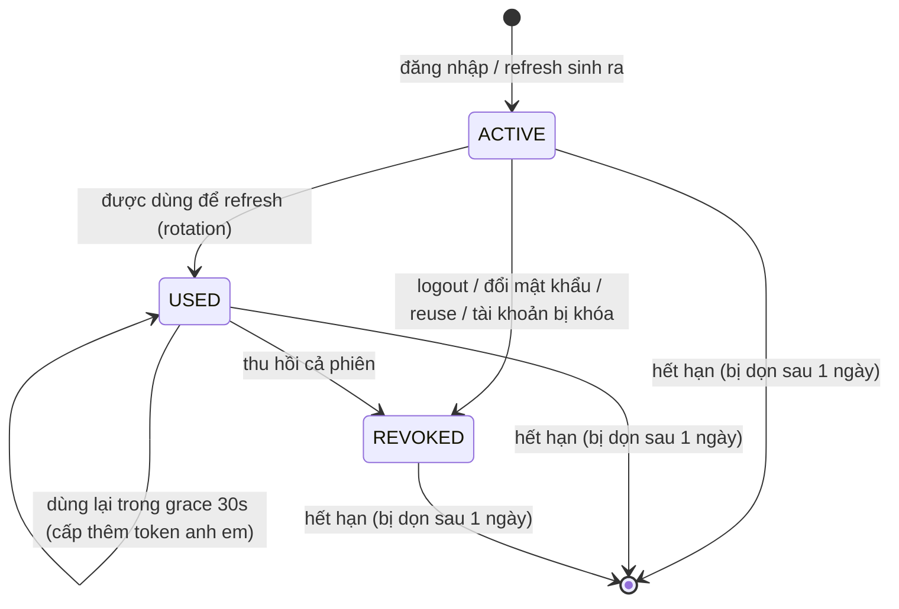
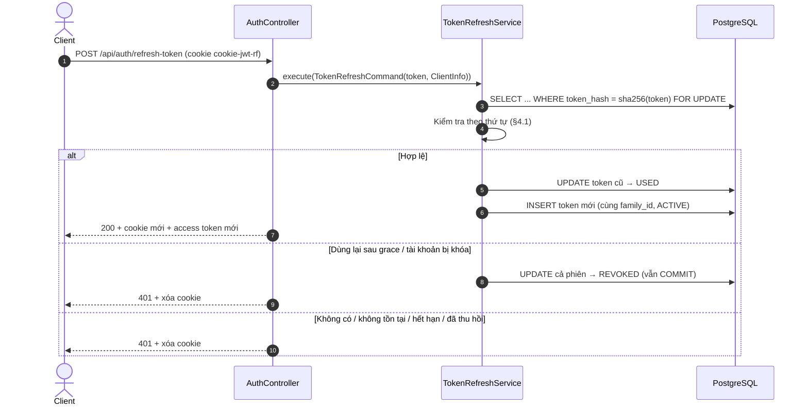

 # 03. ĐẶC TẢ NGHIỆP VỤ REFRESH TOKEN & PHIÊN ĐĂNG NHẬP (SESSION)
## Module `auth-service` · `POST /api/auth/refresh-token`, `/logout`, `/logout-all`

---

## 1. MỤC TIÊU

| Mục tiêu | Cách đạt được |
|---|---|
| Người dùng đang hoạt động **không bị đăng xuất bất ngờ** | Access token hết hạn sau 15 phút thì client tự đổi lấy token mới, người dùng không nhận ra |
| Mở nhiều tab hoặc mạng chập chờn **không làm mất phiên** | Grace period 30 giây cho token vừa được đổi |
| Token bị lộ thì **chỉ dùng được trong thời gian ngắn và bị phát hiện** | Rotation (token chỉ dùng 1 lần) + phát hiện dùng lại → thu hồi cả phiên |
| Người dùng **kiểm soát phiên** | Đăng xuất 1 thiết bị, đăng xuất mọi thiết bị; đổi/đặt lại mật khẩu đăng xuất thiết bị khác |
| Phiên **không kéo dài vô hạn** | Hạn idle 7 ngày, hạn tuyệt đối 30 ngày |

Mô hình này giống cách các dịch vụ phổ biến (Auth0, Okta, Google) làm: refresh token rotation, reuse detection, grace period.

---

## 2. KHÁI NIỆM

### 2.1. Hai loại token

| | Access token | Refresh token |
|---|---|---|
| Dạng | JWT ký HS256 | Chuỗi ngẫu nhiên 256-bit (base64url), không mang thông tin |
| Thời hạn | 15 phút | Idle 7 ngày (trượt), tối đa 30 ngày/phiên |
| Dùng để | Gọi API | Chỉ để đổi lấy cặp token mới hoặc đăng xuất |
| Nơi gửi | Header `Authorization: Bearer` hoặc cookie `cookie-jwt` (`Path=/`) | **Chỉ** cookie `cookie-jwt-rf` (`Path=/api/auth`, HttpOnly) |
| Lưu ở server | Không lưu | Bảng `refresh_tokens`, **chỉ lưu SHA-256** |
| Thu hồi | Không thu hồi được; tự hết hạn sau ≤ 15 phút | Thu hồi tức thì |

### 2.2. Phiên (session / token family)

- Mỗi lần đăng nhập (kể cả đăng nhập tự động sau đăng ký hoặc đổi mật khẩu) tạo **một phiên** với `family_id` riêng.
- Mỗi lần refresh tạo **một token mới trong cùng phiên**, nên một phiên là một chuỗi token nối tiếp nhau.
- Đăng xuất hoặc thu hồi là thu hồi **cả phiên**.

```
Đăng nhập           refresh            refresh            refresh
   │                  │                  │                  │
   ▼                  ▼                  ▼                  ▼
 [T1] ──used──▶ [T2] ──used──▶ [T3] ──used──▶ [T4 ACTIVE]      family_id = F
```

### 2.3. Vòng đời một refresh token



"Hết hạn" không phải là một trạng thái được lưu; nó được tính tại thời điểm token được gửi lên.

### 2.4. Hai mốc hết hạn

| Mốc | Cột | Quy tắc |
|---|---|---|
| **Idle** | `expires_at` | `issued_at + 7 ngày`. Mỗi lần refresh tạo token mới nên hạn idle được tính lại từ đầu (trượt). Không dùng app 7 ngày thì phải đăng nhập lại |
| **Tuyệt đối** | `session_expires_at` | Cố định = thời điểm đăng nhập + 30 ngày. Dù dùng app liên tục, sau 30 ngày vẫn phải đăng nhập lại |

Hạn của token mới = `min(now + 7 ngày, session_expires_at)`.

---

## 3. API

### 3.1. `POST /api/auth/refresh-token` — đổi token

- **Public** (không cần access token, vì thường được gọi đúng lúc access token đã hết hạn).
- Không có body. Refresh token lấy từ cookie `cookie-jwt-rf`; trình duyệt tự gửi khi request có `credentials: 'include'`.

**Thành công** — HTTP `200`, cùng định dạng với đăng nhập:

```http
Set-Cookie: cookie-jwt=<access token mới>; Path=/; Max-Age=900; Secure; HttpOnly; SameSite=Strict
Set-Cookie: cookie-jwt-rf=<refresh token mới>; Path=/api/auth; Max-Age=604800; Secure; HttpOnly; SameSite=Strict
```

```json
{
  "code": 200,
  "message": "Token refreshed successfully.",
  "result": {
    "tokenType": "JWT",
    "accessToken": "eyJ0eXAiOiJKV1Qi...",
    "expiresIn": 900,
    "username": "0912345678",
    "userEmail": null,
    "roles": ["TENANT"],
    "message": "Token refreshed successfully."
  }
}
```

`roles` và `userEmail` lấy từ DB tại thời điểm refresh, nên client có thể cập nhật thông tin người dùng sau mỗi lần refresh.

**Thất bại** — HTTP `401`, **xóa cả hai cookie**:

```http
Set-Cookie: cookie-jwt=; Path=/; Max-Age=0; ...
Set-Cookie: cookie-jwt-rf=; Path=/api/auth; Max-Age=0; ...
```

```json
{ "code": 401, "message": "Your session has expired. Please sign in again.", "errorTime": "2026-10-09T09:16:46.44Z" }
```

Mọi nguyên nhân thất bại đều trả **cùng một message** để không lộ thông tin cho kẻ tấn công. Nguyên nhân cụ thể chỉ được ghi vào log server.

### 3.2. `POST /api/auth/logout` — đăng xuất thiết bị hiện tại

- **Public** và **idempotent**: access token đã hết hạn vẫn đăng xuất được; gọi nhiều lần không lỗi; không có cookie cũng không lỗi.
- Thu hồi cả phiên chứa refresh token trong cookie (lý do `LOGOUT`). Các phiên ở thiết bị khác không bị ảnh hưởng.
- Luôn trả `200` và xóa cả hai cookie:

```json
{ "code": 200, "message": "Logged out successfully." }
```

### 3.3. `POST /api/auth/logout-all` — đăng xuất mọi thiết bị

- **Cần access token** hợp lệ.
- Thu hồi mọi phiên của tài khoản (lý do `LOGOUT_ALL`) và xóa cookie của thiết bị hiện tại.

```json
{ "code": 200, "message": "Logged out from all devices successfully." }
```

---

## 4. LUỒNG XỬ LÝ REFRESH



### 4.1. Thứ tự kiểm tra (`TokenRefreshService`)

| # | Điều kiện | Xử lý |
|---|---|---|
| 1 | Cookie không có hoặc rỗng | 401 |
| 2 | Không tìm thấy token theo hash | 401 |
| 3 | Token `REVOKED` | 401 |
| 4 | Đã quá `expires_at` hoặc `session_expires_at` | 401 |
| 5 | Token `USED`, được dùng **trong vòng 30 giây** | Chấp nhận (§4.2): cấp thêm một token mới, không thu hồi |
| 6 | Token `USED`, được dùng **quá 30 giây** | **Phát hiện dùng lại** (§4.3): thu hồi cả phiên (`REUSE_DETECTED`), log `WARN`, 401 |
| 7 | Chủ tài khoản không còn tồn tại (xóa mềm) hoặc bị `LOCK`/`TERMINATED`/`DELETED` | Thu hồi cả phiên (`ACCOUNT_INACTIVE`), 401 |
| 8 | Hợp lệ | Rotation: token cũ thành `USED` (ghi `used_at`), sinh token mới cùng `family_id`, cấp access token mới, cập nhật User-Agent/IP |

**Khóa dòng (pessimistic lock)**: token được đọc bằng `SELECT ... FOR UPDATE`. Hai request refresh đồng thời với cùng một token sẽ được xử lý **lần lượt**, không bao giờ cùng thấy trạng thái `ACTIVE`.

**Thu hồi vẫn được lưu khi trả lỗi**: service dùng `@Transactional(noRollbackFor = InvalidRefreshTokenException.class)`. Nhờ vậy, ở bước 6 và 7, request trả 401 nhưng việc thu hồi phiên vẫn được commit. Có integration test (`TokenRefreshServiceTransactionTest`) bảo vệ hành vi này.

### 4.2. Grace period — vì sao cần

Tình huống thực tế: người dùng mở **hai tab**, access token của cả hai cùng hết hạn, và cả hai gửi refresh cùng lúc với **cùng một cookie** `T1`.

```
Tab A ──refresh(T1)──▶ server: T1 → USED, cấp T2 ──▶ Tab A nhận T2
Tab B ──refresh(T1)──▶ server: T1 đã USED, nhưng chỉ cách 0.2s (< 30s)
                       → chấp nhận, cấp T3 ──────────▶ Tab B nhận T3
```

T2 và T3 đều `ACTIVE` trong cùng phiên. Cookie cuối cùng trình duyệt giữ (T2 hoặc T3) đều dùng tiếp được. Nếu không có grace period, Tab B sẽ bị đăng xuất, hoặc tệ hơn là cả phiên bị thu hồi oan vì bị coi là "token bị đánh cắp".

Trường hợp tương tự: request refresh thành công nhưng response bị mất do mạng chập chờn, và client gửi lại với token cũ.

### 4.3. Phát hiện dùng lại — vì sao an toàn

Mỗi refresh token chỉ dùng được một lần. Nếu kẻ tấn công lấy được token và dùng nó, thì token đó sẽ bị dùng **hai lần** (một lần bởi kẻ tấn công, một lần bởi người dùng thật). Lần thứ hai, sau grace period, sẽ:

1. Thu hồi **toàn bộ phiên**, kể cả token mới nhất mà kẻ tấn công đang giữ.
2. Ghi log cảnh báo: `Refresh token reuse detected for user <id>: session <family_id> revoked`.
3. Người dùng thật phải đăng nhập lại, còn kẻ tấn công mất quyền truy cập.

---

## 5. CÁC SỰ KIỆN THU HỒI PHIÊN

| Sự kiện | Phạm vi | `revoke_reason` |
|---|---|---|
| `POST /api/auth/logout` | Phiên hiện tại | `LOGOUT` |
| `POST /api/auth/logout-all` | Mọi phiên của tài khoản | `LOGOUT_ALL` |
| Đổi mật khẩu (`/change-password`) | Mọi phiên (thiết bị hiện tại được cấp phiên mới ngay) | `PASSWORD_CHANGED` |
| Đặt lại mật khẩu qua OTP (`/reset-password`) | Mọi phiên (không cấp phiên mới) | `PASSWORD_RESET` |
| Token bị dùng lại sau grace period | Phiên chứa token đó | `REUSE_DETECTED` |
| Refresh khi tài khoản bị khóa / xóa | Phiên chứa token đó | `ACCOUNT_INACTIVE` |

Thu hồi chỉ áp dụng cho refresh token. **Access token đã phát vẫn hợp lệ tới khi hết hạn (≤ 15 phút)**, trừ khi tài khoản bị khóa/xóa: trường hợp đó bị chặn ngay ở mỗi request (xem [02_AUTH_LOGIN_FLOW.md](02_AUTH_LOGIN_FLOW.md) §4).

---

## 6. LƯU TRỮ

### 6.1. Bảng `refresh_tokens`

Migration: `V202610091400__create_refresh_tokens_table.sql`.

| Cột | Kiểu | Ý nghĩa |
|---|---|---|
| `id` | `BIGINT` PK | Snowflake ID |
| `user_id` | `VARCHAR(26)` FK → `users.id` | Chủ phiên |
| `family_id` | `UUID` | ID phiên |
| `token_hash` | `VARCHAR(64)` UNIQUE | SHA-256 (hex) của refresh token |
| `status` | `VARCHAR(20)` | `ACTIVE` / `USED` / `REVOKED` |
| `issued_at` | `TIMESTAMPTZ` | Thời điểm phát hành |
| `expires_at` | `TIMESTAMPTZ` | Hạn idle của token này |
| `session_expires_at` | `TIMESTAMPTZ` | Hạn tuyệt đối của phiên |
| `used_at` | `TIMESTAMPTZ` | Lần đầu được dùng để refresh |
| `revoked_at`, `revoke_reason` | | Thời điểm và lý do thu hồi |
| `user_agent`, `ip_address` | | Thiết bị đã nhận token (chỉ để truy vết) |

Index: `family_id`, `user_id`, `expires_at`.

Vì sao chỉ lưu hash? Token có 256 bit ngẫu nhiên nên không thể dò ngược, và SHA-256 là đủ. Nếu DB bị lộ, kẻ tấn công không có token nào dùng được.

### 6.2. Dọn dẹp

`RefreshTokenCleanupScheduler` chạy hằng ngày lúc **03:30** (giờ server). Job xóa các token có `expires_at` đã qua **hơn 1 ngày**; giữ thêm 1 ngày để còn truy vết được các lỗi refresh gần đây.

---

## 7. CẤU HÌNH

| Thuộc tính (`application.yml`) | Mặc định | Ý nghĩa |
|---|---|---|
| `app.jwt.expiration.minutes` | `15` | Thời hạn access token |
| `app.jwt.jwtRefreshExpirationMs` | `604800000` (7 ngày) | Hạn idle của refresh token; cũng là `Max-Age` của cookie |
| `app.jwt.refreshAbsoluteExpirationMs` | `2592000000` (30 ngày) | Hạn tuyệt đối của phiên |
| `app.jwt.refreshReuseGraceSeconds` | `30` | Grace period cho token vừa được đổi |
| `app.jwt.refreshCleanupCron` | `0 30 3 * * *` | Lịch dọn token hết hạn |
| `app.jwt.jwtRefreshCookieName` | `cookie-jwt-rf` | Tên cookie refresh token |

Ràng buộc khi khởi động (`RefreshTokenPolicy`): hạn idle > 0, hạn tuyệt đối ≥ hạn idle, grace ≥ 0. Sai thì ứng dụng không khởi động.

---

## 8. HƯỚNG DẪN TÍCH HỢP CLIENT

### 8.1. Quy tắc

1. Mọi request gửi kèm `credentials: 'include'` để trình duyệt gửi cookie.
2. Gặp **401** ở API thường thì gọi `POST /api/auth/refresh-token` **một lần**, rồi gửi lại request ban đầu.
3. Nếu chính `/refresh-token` trả 401 thì chuyển về màn đăng nhập. **Không thử lại**.
4. **Chỉ một request refresh tại một thời điểm** trong mỗi tab: các request khác chờ kết quả của lần refresh đang chạy.
5. Không áp dụng tự refresh cho `/api/auth/login`, `/api/auth/refresh-token`, `/api/auth/logout`.
6. Tùy chọn: refresh chủ động khi gần hết `expiresIn` (ví dụ còn 60 giây) để tránh request bị 401.

### 8.2. Ví dụ (fetch wrapper)

```javascript
let refreshing = null; // single-flight: mọi request dùng chung một lần refresh

async function refreshSession() {
  if (!refreshing) {
    refreshing = fetch('/api/auth/refresh-token', { method: 'POST', credentials: 'include' })
      .then((res) => {
        if (!res.ok) throw new Error('SESSION_EXPIRED');
        return res.json();
      })
      .finally(() => { refreshing = null; });
  }
  return refreshing;
}

export async function api(url, options = {}) {
  const send = () => fetch(url, { ...options, credentials: 'include' });
  let res = await send();
  if (res.status === 401 && !url.startsWith('/api/auth/')) {
    try {
      await refreshSession();
    } catch {
      window.location.assign('/login');
      throw new Error('SESSION_EXPIRED');
    }
    res = await send(); // gửi lại đúng một lần
  }
  return res;
}
```

Client dùng header `Authorization` (mobile/SPA lưu token trong bộ nhớ) thì lấy `result.accessToken` từ response login/refresh. Refresh token vẫn chỉ đi bằng cookie; HTTP client của mobile cần bật cookie jar.

---

## 9. BẢO MẬT

| Rủi ro | Biện pháp |
|---|---|
| XSS đọc refresh token | Cookie `HttpOnly`, không bao giờ có trong body |
| Refresh token bị gửi tới endpoint không cần | Cookie `Path=/api/auth` |
| CSRF gọi refresh/logout từ site khác | `SameSite=Strict` (CSRF của Spring Security đang tắt; đổi sang `SameSite=None` thì phải bật lại) |
| Lộ DB | Chỉ lưu SHA-256 của token |
| Token bị đánh cắp | Rotation + reuse detection + hạn idle/tuyệt đối |
| Hai request refresh đồng thời | Khóa dòng `FOR UPDATE` + grace period |
| Dò thông tin qua lỗi | Mọi lỗi refresh cùng một message |
| Lộ token qua log | Không log token; chỉ log `family_id` và user id |

User-Agent và IP **không** được dùng để chặn: IP mạng di động đổi liên tục, nên ràng buộc vào IP sẽ đăng xuất người dùng vô cớ. IP là địa chỉ peer trực tiếp; khi chạy sau reverse proxy cần cấu hình `server.forward-headers-strategy` để lấy đúng IP client.

---

## 10. THÀNH PHẦN MÃ NGUỒN

| Tầng | Lớp |
|---|---|
| Presentation | `AuthController` (`/refresh-token`, `/logout`, `/logout-all`), `AuthExceptionHandler` (401 + xóa cookie), `RefreshTokenCleanupScheduler` |
| Application | `TokenRefreshUseCase` / `TokenRefreshService`, `LogoutUseCase` / `LogoutService`, `RefreshTokenGenerateService`, `ExpiredRefreshTokenPurgeService`, `AuthResultAssembler`, `RefreshTokenPolicy`, `RefreshTokenSecrets`, `InvalidRefreshTokenException` |
| Domain | `RefreshToken` (`startSession`, `rotate`, `isExpired`, `isWithinReuseGrace`), `TokenStatus`, `RevokeReason`, `RefreshTokenDomainRepository` |
| Infrastructure | `RefreshTokenRepositoryAdapter`, `RefreshTokenJpaRepository`, `RefreshTokenEntity`, `RefreshTokenEntityMapper`, `CookieService`, `AuthSchedulingConfig` |

Test:
- `RefreshTokenTest`: quy tắc domain.
- `TokenRefreshServiceTest`: rotation, grace, reuse, hết hạn idle/tuyệt đối, tài khoản bị khóa/xóa.
- `TokenRefreshServiceTransactionTest`: thu hồi vẫn được commit khi trả 401.
- `LogoutServiceTest`.
- `RefreshTokenRepositoryAdapterTest`: tìm theo hash, unique hash, thu hồi theo phiên/tài khoản, dọn dẹp.
- `JWTRequestFilterTest`: đọc token từ cookie, token hết hạn.
- `PasswordChangeServiceTest`, `PasswordResetServiceTest`: thu hồi phiên khi đổi/đặt lại mật khẩu.

---

## 11. HẠN CHẾ & HƯỚNG PHÁT TRIỂN

1. **Thu hồi access token tức thì**: thêm claim `sid` (session id) vào JWT và kiểm tra phiên ở mỗi request. Hiện access token còn hiệu lực ≤ 15 phút sau khi phiên bị thu hồi.
2. **Màn hình "Thiết bị đang đăng nhập"**: liệt kê phiên (User-Agent, IP, thời điểm) và đăng xuất từng thiết bị. Dữ liệu đã có sẵn trong `refresh_tokens`.
3. **Header chuẩn RFC 6750** `WWW-Authenticate: Bearer error="invalid_token"` khi access token hết hạn, để client phân biệt "hết hạn" với "không có quyền".
4. **Thông báo bảo mật**: gửi email/push cho người dùng khi phát hiện `REUSE_DETECTED`.
5. Bảng `refresh_token` cũ (do Hibernate tạo trước đây) không còn dùng, có thể xóa ở các DB đã tồn tại.
