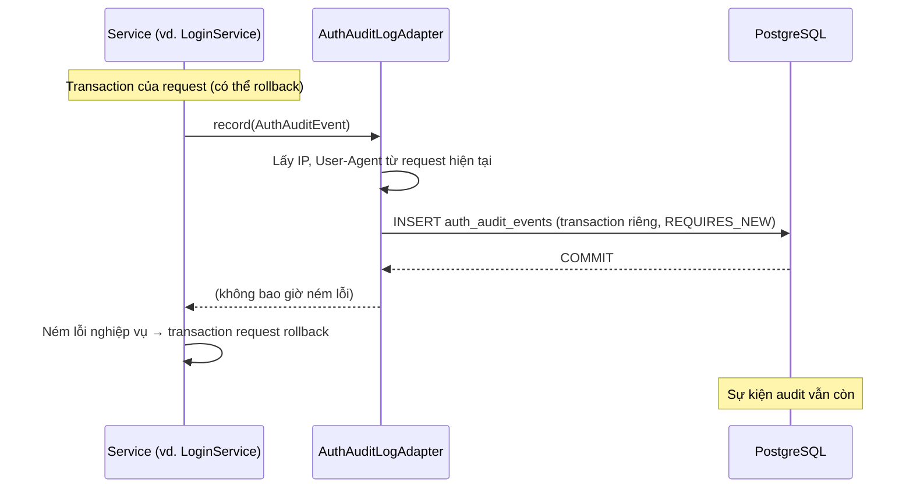

# 04. ĐẶC TẢ NHẬT KÝ BẢO MẬT (SECURITY AUDIT LOG)
## Module `auth-service` · Bảng `auth_audit_events`

---

## 1. MỤC TIÊU

Lưu lại **ai, làm gì, lúc nào, từ đâu** với mọi sự kiện bảo mật của auth-service, để:
- **điều tra sự cố**: tài khoản bị chiếm, bị dò mật khẩu, token bị đánh cắp;
- **phát hiện tấn công**: nhiều lần đăng nhập sai từ một IP, dò email ở quên mật khẩu;
- **hỗ trợ người dùng**: "tôi không đăng nhập được", "tôi không đổi mật khẩu này".

Log ứng dụng (stdout) vẫn giữ nguyên. Audit log là bản ghi có cấu trúc, truy vấn được bằng SQL và có thời hạn lưu trữ rõ ràng.

---

## 2. CÁC SỰ KIỆN ĐƯỢC GHI

| `event_type` | Khi nào | `user_id` | `subject` | `details` |
|---|---|---|---|---|
| `USER_REGISTERED` | Đăng ký thành công | Tài khoản mới | Số điện thoại | — |
| `LOGIN_SUCCEEDED` | Đăng nhập thành công (kể cả tự động sau đăng ký / đổi mật khẩu) | ✔ | Số điện thoại | — |
| `LOGIN_FAILED` | Sai thông tin, hoặc tài khoản bị `LOCK`/vô hiệu | ✔ nếu tài khoản tồn tại, ngược lại `NULL` | Số điện thoại đã nhập | `BAD_CREDENTIALS` / `ACCOUNT_DISABLED` |
| `ACCOUNT_TEMPORARILY_LOCKED` | Lần sai thứ 5, 10, ... kích hoạt khóa tạm | ✔ | Số điện thoại | `attempts=5, lock=PT15M` |
| `LOGIN_BLOCKED` | Đăng nhập trong lúc đang bị khóa tạm | ✔ | Số điện thoại | `TEMPORARILY_LOCKED` |
| `LOGOUT` | Đăng xuất một thiết bị | ✔ | — | `session=<family_id>` |
| `LOGOUT_ALL_DEVICES` | Đăng xuất mọi thiết bị | ✔ | Số điện thoại | — |
| `REFRESH_TOKEN_REUSE_DETECTED` | Refresh token đã dùng bị gửi lại sau grace period → thu hồi phiên | ✔ | — | `session=<family_id>` |
| `REFRESH_REJECTED_ACCOUNT_INACTIVE` | Refresh khi tài khoản đã bị khóa/xóa → thu hồi phiên | ✔ | — | `session=<family_id>` |
| `PASSWORD_CHANGED` | Đổi mật khẩu thành công | ✔ | Số điện thoại | — |
| `PASSWORD_CHANGE_FAILED` | Nhập sai mật khẩu hiện tại | ✔ | Số điện thoại | `WRONG_CURRENT_PASSWORD` |
| `PASSWORD_RESET_REQUESTED` | Gọi quên mật khẩu | ✔ nếu có tài khoản | Email | `SENT` / `COOLDOWN_NOT_SENT` / `NO_ELIGIBLE_ACCOUNT` |
| `PASSWORD_RESET_COMPLETED` | Đặt lại mật khẩu thành công | ✔ | Email | — |
| `PASSWORD_RESET_FAILED` | Đặt lại mật khẩu bị từ chối | ✔ nếu biết token | Email | `UNKNOWN_TOKEN` / `TOKEN_EXPIRED_OR_USED` / `WRONG_OTP attempt=N` / `TOKEN_BURNED_AFTER_WRONG_OTP` / `ACCOUNT_DISABLED` |

Mọi dòng đều có thêm `ip_address`, `user_agent` (lấy tự động từ request) và `occurred_at`.

**Không bao giờ ghi bí mật**: mật khẩu, OTP, reset token, access/refresh token đều không xuất hiện trong audit log.

Cố ý **không** ghi:
- Refresh thành công: diễn ra mỗi 15 phút với mỗi người dùng đang hoạt động, quá nhiều mà ít giá trị.
- Request bị rate limit (429): khi bị tấn công số lượng rất lớn. Các request này được ghi ở log ứng dụng mức `WARN`.

---

## 3. CƠ CHẾ GHI



| Nguyên tắc | Lý do |
|---|---|
| **Transaction riêng** (`REQUIRES_NEW`) | Phần lớn sự kiện bảo mật kết thúc bằng exception (sai mật khẩu, OTP sai, token bị dùng lại). Nếu ghi chung transaction, chúng sẽ bị rollback mất. Integration test `AuthAuditLogAdapterTest` bảo vệ hành vi này |
| **Không bao giờ ném lỗi** | Audit log hỏng (DB chậm, đầy) không được làm hỏng đăng nhập. Lỗi được ghi `ERROR` ra log ứng dụng |
| **Chỉ thêm, không sửa** | Bảng append-only; chỉ bị xóa bởi job dọn theo thời hạn lưu trữ |
| **Cắt độ dài** | `subject` ≤ 100, `details` ≤ 255, `user_agent` ≤ 255, `ip_address` ≤ 45 ký tự |

Service gọi qua port `AuditLogPort` (tầng application), nên có thể thay adapter (ví dụ đẩy sang SIEM hoặc Kafka) mà không đổi nghiệp vụ.

---

## 4. LƯU TRỮ

```sql
CREATE TABLE auth_audit_events (
    id BIGINT NOT NULL PRIMARY KEY,         -- Snowflake ID
    event_type VARCHAR(50) NOT NULL,
    user_id VARCHAR(26),                    -- NULL khi không xác định được tài khoản
    subject VARCHAR(100),                   -- số điện thoại / email client đã dùng
    details VARCHAR(255),
    ip_address VARCHAR(45),
    user_agent VARCHAR(255),
    occurred_at TIMESTAMP WITH TIME ZONE NOT NULL
);
-- Index: (user_id, occurred_at), (event_type, occurred_at), (ip_address, occurred_at), (occurred_at)
```

Migration: `V202610091600__create_auth_audit_events_table.sql`.

**Thời hạn lưu trữ**: 180 ngày (`app.security.audit.retention`). `AuditLogCleanupScheduler` xóa dữ liệu cũ hằng ngày lúc 04:00 (`app.security.audit.cleanup-cron`).

`subject` và `ip_address` là **dữ liệu cá nhân**. Thời hạn lưu trữ cần thống nhất với chính sách bảo vệ dữ liệu cá nhân của công ty (Nghị định 13/2023/NĐ-CP).

---

## 5. TRUY VẤN THƯỜNG DÙNG

```sql
-- Lịch sử bảo mật của một tài khoản
SELECT occurred_at, event_type, details, ip_address, user_agent
FROM auth_audit_events WHERE user_id = :userId ORDER BY occurred_at DESC LIMIT 100;

-- IP dò mật khẩu trong 1 giờ qua
SELECT ip_address, COUNT(*) AS failures, COUNT(DISTINCT subject) AS accounts
FROM auth_audit_events
WHERE event_type = 'LOGIN_FAILED' AND occurred_at > now() - interval '1 hour'
GROUP BY ip_address HAVING COUNT(*) > 20 ORDER BY failures DESC;

-- Nghi token bị đánh cắp trong 7 ngày qua
SELECT occurred_at, user_id, details, ip_address
FROM auth_audit_events
WHERE event_type = 'REFRESH_TOKEN_REUSE_DETECTED' AND occurred_at > now() - interval '7 days';

-- Dò email qua quên mật khẩu
SELECT ip_address, COUNT(*) FROM auth_audit_events
WHERE event_type = 'PASSWORD_RESET_REQUESTED' AND details = 'NO_ELIGIBLE_ACCOUNT'
  AND occurred_at > now() - interval '1 day'
GROUP BY ip_address ORDER BY 2 DESC;
```

---

## 6. CẤU HÌNH

| Thuộc tính | Mặc định | Ý nghĩa |
|---|---|---|
| `app.security.audit.retention` | `180d` | Thời gian giữ sự kiện |
| `app.security.audit.cleanup-cron` | `0 0 4 * * *` | Lịch dọn dữ liệu cũ |

---

## 7. THÀNH PHẦN MÃ NGUỒN

| Tầng | Lớp |
|---|---|
| Application (port) | `AuditLogPort`, `AuthAuditEvent`, `AuditEventType` |
| Infrastructure | `AuthAuditLogAdapter`, `AuthAuditEventEntity`, `AuthAuditEventJpaRepository` |
| Presentation | `AuditLogCleanupScheduler` |
| Nơi ghi sự kiện | `LoginService`, `UserRegisterService`, `LogoutService`, `TokenRefreshService`, `PasswordChangeService`, `PasswordForgotService`, `PasswordResetService` |

Test:
- `AuthAuditLogAdapterTest`: vẫn còn sau rollback, lấy IP/UA, cắt độ dài, không ném lỗi, dọn dữ liệu.
- Các test service kiểm tra đúng loại sự kiện được ghi (dùng `RecordingAuditLog`).

---

## 8. HẠN CHẾ & HƯỚNG PHÁT TRIỂN

1. **Chưa có API/màn hình xem audit** cho quản trị viên hoặc trang "hoạt động bảo mật" cho người dùng.
2. **Chưa có cảnh báo tự động** (email/Slack khi có `REFRESH_TOKEN_REUSE_DETECTED`, hoặc khi một IP đăng nhập sai hàng loạt).
3. **Ghi đồng bộ**: mỗi sự kiện tốn thêm một INSERT và một kết nối DB tạm thời. Khi tải lớn có thể chuyển sang ghi bất đồng bộ qua hàng đợi.
4. Bảng có thể bị sửa bởi người có quyền DB. Nếu cần chống chối bỏ (tamper-evident), cân nhắc chuỗi hash hoặc đẩy sang kho log bất biến.
