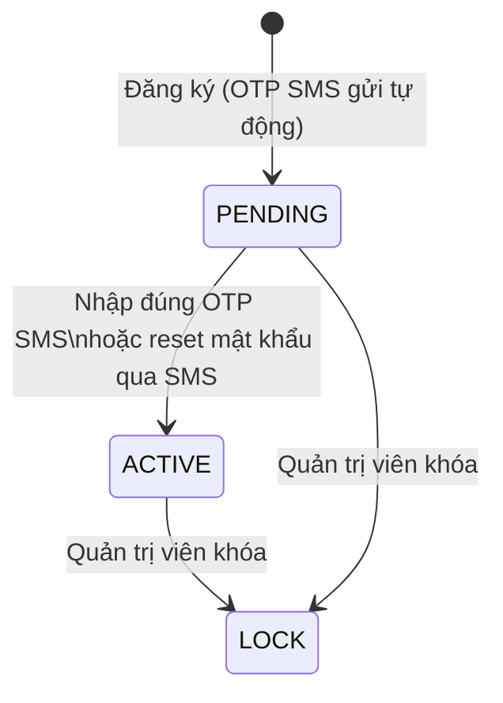
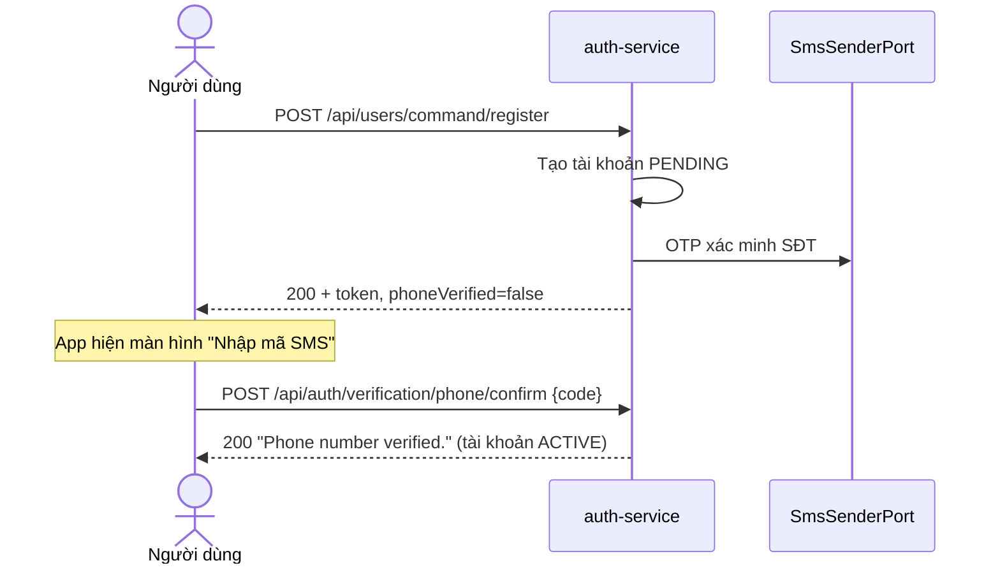

# 05. ĐẶC TẢ XÁC MINH SỐ ĐIỆN THOẠI & EMAIL (CONTACT VERIFICATION)
## Module `auth-service` · `/api/auth/verification/*`, `/api/auth/forgot-password/sms`

---

## 1. MỤC TIÊU & QUYẾT ĐỊNH NGHIỆP VỤ

| Vấn đề | Quyết định |
|---|---|
| Đăng ký bằng số điện thoại của người khác | **Tạo tài khoản trước, xác minh sau**: tài khoản mới ở trạng thái `PENDING` và nhận ngay OTP SMS. Nhập đúng thì chuyển sang `ACTIVE` |
| Đăng ký bằng email giả / của người khác | Email được gửi mã xác minh khi được thêm vào. **Email chưa xác minh không dùng được cho quên mật khẩu** |
| Người dùng không có email không reset được mật khẩu | Thêm **quên mật khẩu qua OTP SMS** |
| Nhà cung cấp SMS | Mới làm **abstraction** (`SmsSenderPort`). Bản dev chỉ ghi SMS ra log; gắn nhà cung cấp thật sau |

**Chống chiếm số điện thoại**: vì tài khoản được tạo trước khi xác minh, kẻ xấu có thể đăng ký trước bằng số của bạn. Khi đó chủ thật của số dùng **quên mật khẩu qua SMS**: mã đến đúng điện thoại của họ, nên reset thành công đồng nghĩa đã chứng minh sở hữu số. Tài khoản chuyển sang tay họ và số được đánh dấu đã xác minh.

---

## 2. TRẠNG THÁI TÀI KHOẢN



| Trạng thái | Đăng nhập | Quyền `PHONE_VERIFIED` |
|---|---|---|
| `PENDING` | Được (để vào app nhập OTP) | Không |
| `ACTIVE` (đã xác minh SĐT) | Được | Có |

**Giới hạn tính năng với tài khoản chưa xác minh**: auth-service cấp authority `PHONE_VERIFIED` / `EMAIL_VERIFIED` cho tài khoản đã xác minh. Module khác chặn hành động quan trọng bằng:

```java
@PreAuthorize("hasAuthority('PHONE_VERIFIED')")
public BookingId createBooking(...) { ... }
```

Frontend biết trạng thái qua `phoneVerified` / `emailVerified` trong response login/register/refresh và `GET /api/user/query/my-info` (kèm `accountStatus`).

Tài khoản tồn tại trước khi có tính năng này giữ nguyên trạng thái, nhưng `phone_verified_at = NULL` (chưa có authority `PHONE_VERIFIED`).

---

## 3. API XÁC MINH (cần access token)

| Method | Endpoint | Body | Kết quả |
|---|---|---|---|
| POST | `/api/auth/verification/phone/send` | — | Gửi OTP SMS mới |
| POST | `/api/auth/verification/phone/confirm` | `{ "code": "123456" }` | Xác minh SĐT, `PENDING` → `ACTIVE` |
| POST | `/api/auth/verification/email/send` | — | Gửi mã qua email |
| POST | `/api/auth/verification/email/confirm` | `{ "code": "123456" }` | Xác minh email |

Response của `send`:

```json
{
  "code": 200,
  "message": "Verification code sent by SMS.",
  "result": {
    "channel": "PHONE",
    "sentTo": "091****678",
    "expiresAt": "2026-10-09T15:39:09Z",
    "resendAvailableAt": "2026-10-09T15:30:09Z"
  }
}
```

### 3.1. Quy tắc mã xác minh

| Quy tắc | Mặc định | Cấu hình |
|---|---|---|
| Độ dài / hiệu lực | 6 chữ số, 10 phút | `app.security.verification.code-lifetime` |
| Nhập sai tối đa | 5 lần, sau đó mã bị hủy | `...max-attempts` |
| Cooldown gửi lại | 60 giây (trả **429** + `Retry-After`) | `...resend-cooldown` |
| Hạn mức / ngày | 5 mã mỗi tài khoản mỗi kênh (SMS tốn tiền) | `...max-codes-per-day` |

- Mỗi tài khoản/kênh chỉ có **một mã dùng được**: gửi mã mới thì mã cũ bị hủy.
- Mã **gắn với địa chỉ đã nhận**: đổi email sau khi gửi thì mã cũ không xác minh được email mới.
- Đổi email (`AppUser.changeEmail`) xóa trạng thái đã xác minh.
- Chỉ lưu **SHA-256 có salt** của mã (bảng `verification_codes`), so khớp constant-time.
- Số lần nhập sai được **commit dù request lỗi** (`ContactVerificationServiceTransactionTest`).
- Rate limit theo IP: send 5/giờ, confirm 10/15 phút.

### 3.2. Lỗi

| Tình huống | HTTP | Message |
|---|---|---|
| Sai mã (còn lượt) | 400 | `Incorrect verification code.` |
| Sai lần thứ 5 | 400 | `Too many incorrect codes. Please request a new one.` |
| Không có mã / hết hạn / đã dùng / đã đổi email | 400 | `The verification code is invalid or has expired. Please request a new one.` |
| Đã xác minh rồi | 400 | `This contact is already verified.` |
| Tài khoản không có email | 400 | `There is no email on this account to verify.` |
| Gửi lại quá sớm | 429 + `Retry-After` | `Please wait before requesting another code.` |
| Quá hạn mức ngày | 429 + `Retry-After` | `Too many codes requested today. Please try again later.` |

---

## 4. LUỒNG SAU ĐĂNG KÝ



- Có email khi đăng ký thì cũng gửi mã xác minh email.
- Gửi mã thất bại (nhà cung cấp lỗi) **không làm hỏng đăng ký**; người dùng bấm "Gửi lại mã".

---

## 5. QUÊN MẬT KHẨU QUA SMS

**Bước 1 — `POST /api/auth/forgot-password/sms`** (public)

```json
{ "phoneNumber": "0912345678" }
```

```json
{
  "code": 200,
  "message": "If an account exists for this phone number, a password reset code has been sent by SMS.",
  "result": {
    "message": "...",
    "resetToken": "5b0c1c9e-...",
    "expiresAt": "2026-10-09T15:44:10Z",
    "otpExpirationMinutes": 15
  }
}
```

- **Luôn trả cùng một dạng** và luôn có `resetToken`. Số không tồn tại thì token là ngẫu nhiên vô dụng, nên không dò được số nào đã đăng ký.
- OTP chỉ đi qua SMS, **không bao giờ** nằm trong response.
- Gọi lại trong 60 giây thì trả lại **cùng token**, không gửi SMS mới.
- Tối đa 5 mã mỗi số mỗi ngày.

**Bước 2 — `POST /api/auth/reset-password`**: giống luồng email, gồm `resetToken` + `otpCode` (từ SMS) + mật khẩu mới. Thành công thì:
- số điện thoại được **đánh dấu đã xác minh**, tài khoản `PENDING` → `ACTIVE` (chống chiếm số, §1);
- thông báo "mật khẩu vừa được đặt lại" gửi qua SMS;
- mọi phiên đăng nhập bị thu hồi, khóa đăng nhập tạm được gỡ (như luồng email).

Luồng email (`/forgot-password`) giờ **chỉ gửi cho email đã xác minh**; email chưa xác minh nhận câu trả lời chung và không có gì được gửi.

**Hạn mức chung cho reset** (cả 2 kênh): 5 mã/ngày/đích × 5 lần đoán/mã = tối đa 25 lần đoán OTP mỗi ngày cho một tài khoản.

---

## 6. NHÀ CUNG CẤP SMS

```java
public interface SmsSenderPort {
    void send(String phoneNumber, String message);
}
```

| `app.sms.provider` | Bean | Dùng cho |
|---|---|---|
| `log` | `LoggingSmsSender`: ghi `[DEV SMS - not sent] to 0912...: <nội dung>` ở mức WARN | Profile `dev`, `test` |
| *(trống)* | không có bean nên **ứng dụng không khởi động** | Production khi chưa gắn nhà cung cấp (fail-fast, giống khóa mã hóa CCCD) |

**Không bật `log` ở production**: OTP sẽ nằm trong log.

Gắn nhà cung cấp thật (eSMS, SpeedSMS, Twilio, ...):
1. Viết class `XxxSmsSender implements SmsSenderPort` trong `infrastructure/sms`, kèm `@ConditionalOnProperty(name = "app.sms.provider", havingValue = "xxx")`.
2. Đọc API key từ biến môi trường, không commit vào repo.
3. Đặt `SMS_PROVIDER=xxx` trên môi trường production.
4. Đăng ký brandname/template với nhà mạng. Nội dung SMS hiện là tiếng Việt không dấu, nằm ở `ContactVerificationService` và `PasswordForgotService`.

---

## 7. AUDIT

| Sự kiện | Khi nào |
|---|---|
| `PHONE_VERIFICATION_SENT` / `EMAIL_VERIFICATION_SENT` | Gửi mã |
| `PHONE_VERIFIED` / `EMAIL_VERIFIED` | Xác minh thành công (với SĐT: kể cả qua reset SMS, `details = BY_SMS_PASSWORD_RESET`) |
| `VERIFICATION_FAILED` | Sai mã, mã hết hạn/đã hủy (`details` = kênh + lý do) |
| `PASSWORD_RESET_REQUESTED` | `details` = `EMAIL ...` / `PHONE ...` + `SENT` / `COOLDOWN_NOT_SENT` / `DAILY_LIMIT` / `NO_ELIGIBLE_ACCOUNT` |

---

## 8. LƯU TRỮ

- `users.phone_verified_at`, `users.email_verified_at` (`TIMESTAMPTZ`, NULL = chưa xác minh).
- Bảng `verification_codes`: `id`, `user_id`, `channel` (`PHONE`/`EMAIL`), `destination`, `code_hash`, `created_at`, `expires_at`, `failed_attempts`, `consumed_at`.
- `password_reset_token`: cột `email` đổi thành `destination`, thêm `channel`.

Migration: `V202610091700__add_contact_verification.sql`.

---

## 9. THÀNH PHẦN MÃ NGUỒN

| Tầng | Lớp |
|---|---|
| Presentation | `ContactVerificationController`, `AuthController` (`/forgot-password/sms`), `VerificationConfirmRequest`, `PasswordForgotSmsRequest`, `VerificationSendResponse`, `AuthExceptionHandler` |
| Application | `ContactVerificationUseCase` / `ContactVerificationService`, `VerificationPolicy`, `ContactMasker`, `PasswordForgotService`, `PasswordResetService`, `SmsSenderPort`, `VerificationException`, `VerificationThrottledException` |
| Domain | `VerificationCode`, `VerificationChannel`, `VerificationCodeRepository`, `AppUser` (`verifyPhone`, `verifyEmail`, `changeEmail`), `PasswordResetToken` (`channel`, `destination`) |
| Infrastructure | `VerificationCodeRepositoryAdapter`, `VerificationCodeEntity`, `VerificationCodeJpaRepository`, `LoggingSmsSender`, `EmailService.sendVerificationCodeEmail`, `CustomUserDetailsService` (authority) |
| Hằng số | `AuthAuthorities` (`PHONE_VERIFIED`, `EMAIL_VERIFIED`) |

Test:
- `VerificationCodeTest`, `ContactVerificationServiceTest`, `ContactVerificationServiceTransactionTest`, `VerificationCodeRepositoryAdapterTest`, `ContactMaskerTest`.
- `AppUserTest`, `CustomUserDetailsServiceTest`, `UserRegisterServiceTest`, `PasswordForgotServiceTest`, `PasswordResetServiceTest`.

---

## 10. HẠN CHẾ & VIỆC CÒN LẠI

1. **Chưa có nhà cung cấp SMS thật**: production chưa chạy được cho tới khi gắn (§6).
2. **Tài khoản PENDING không bao giờ hết hạn**: số bị chiếm vẫn lấy lại được qua reset SMS, nhưng nên có job dọn tài khoản PENDING quá N ngày (cần quyết định nghiệp vụ).
3. **Chưa có API cập nhật hồ sơ** (thêm/đổi email sau đăng ký). Logic xác minh đã sẵn: `changeEmail` xóa trạng thái xác minh, rồi gọi `/verification/email/send`.
4. Gửi SMS/email **đồng bộ** trong request: nhà cung cấp chậm thì request chậm theo.
5. Chưa áp `@PreAuthorize("hasAuthority('PHONE_VERIFIED')")` ở module nào; cần quyết định những hành động nào bắt buộc xác minh.
